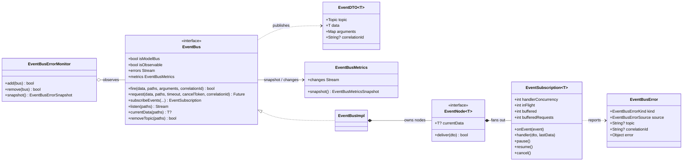
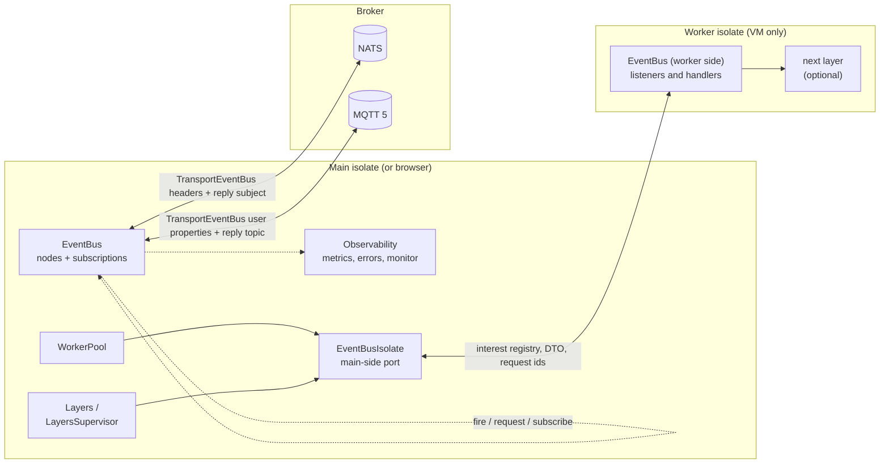

# 00. Start here: the package at a glance

[Next: Architecture →](01-architecture.md)

`event_bus_arch` 4.0 is an event-driven core for Dart and Flutter. Everything talks through
events with an address (a **topic**): `fire` publishes, `request` asks one handler for a result.
Subscriptions own their buffers, handlers own their request queues, and the same model runs in one
isolate, across isolates, or across a broker.

Use these diagrams as the map; the numbered documents explain each part.

## Reading paths

| You are | Read in this order |
|---|---|
| New to the package | 00 → 02 → 11 → 12 → 03 → 13 |
| Building an app on one isolate | 00 → 02 → 11 → 12 |
| Adding isolates, pools or layers | 03 → 13 |
| Connecting a broker | 00 → 08 → 09 or 10 |
| Running on the web | 14 → 02 → 12 |
| Migrating from 3.x | [Migration guide](15-migration-3-to-4.md) → 07 |
| Looking up a type | 06 |

## 1. Public API map

The bus is an interface; `EventBusImpl` is the built-in implementation. A topic is represented by
an `EventNode` that owns its subscriptions; an `EventSubscription` may be a listener, a handler, or
both. Errors and metrics are data, not stream errors.

**What to notice:** `fire` and `request` both build an `EventDTO`; only `request` reaches a
`handler`. A subscription with `onEvent` is a listener, one with `handler` is a responder, and both
callbacks can live on the same subscription.

## 2. Component map

The local bus is the same type in every segment. An isolate bridge and a transport are directional
ports: local listeners receive incoming events, `fire` goes out; `request` resolves a local handler
first and crosses the boundary only when the other side has one.

**What to notice:** isolates are VM-only; the transport seam works on the web, while the shipped
NATS/MQTT connections are VM-only (see 14). Pools and layers are built from the same
`EventBusIsolate`.

## 3. What is new in 4.0

| Area | 4.0 behaviour |
|---|---|
| Subscriptions | `subscribeEvents` returns an `EventSubscription` with its own bounded buffer, pause/resume, resize and overflow policy; `onEvent` and `handler` can be combined |
| Handlers | A handler is a subscription capability, not a node-level registry; per-subscription FIFO queue, `handlerConcurrency`, `inFlight`, `BusyException` |
| Requests | Local handler first, timeout and `CancelToken`, queue removal, dispatched-then-cancelled responses discarded |
| Errors | `EventBus.errors` carries `EventBusError` data events with rate limiting and a bounded recent buffer; `EventBusErrorMonitor` aggregates buses |
| Isolates | Interest registries in both directions, outbound-only bridge `fire`, immediate `NoHandlerException`, cancellation across the bridge, in-place worker restart |
| Pools and layers | `WorkerPool` with five strategies and request credits; `Layers.supervise` restarts the whole worker chain while the top layer survives |
| Observability | Opt-in per-topic/subscription metrics, snapshots, a changes stream, correlation ids; zero hot-path work when disabled |
| Web | The core bus, subscriptions, observability and the transport seam compile and run; isolate APIs throw `UnsupportedError` and report it through `EventBusCapabilities` |
| Dependencies | rxdart is removed; users add it themselves if needed |

## 4. Versions

| Package | Version |
|---|---|
| `event_bus_arch` | 4.0.0 |
| `event_bus_arch_transport` | 0.2.0 |
| `event_bus_arch_mqtt` | 0.2.0 |
| `event_bus_arch_nats` | 1.1.0 |

[Next: Architecture →](01-architecture.md)
