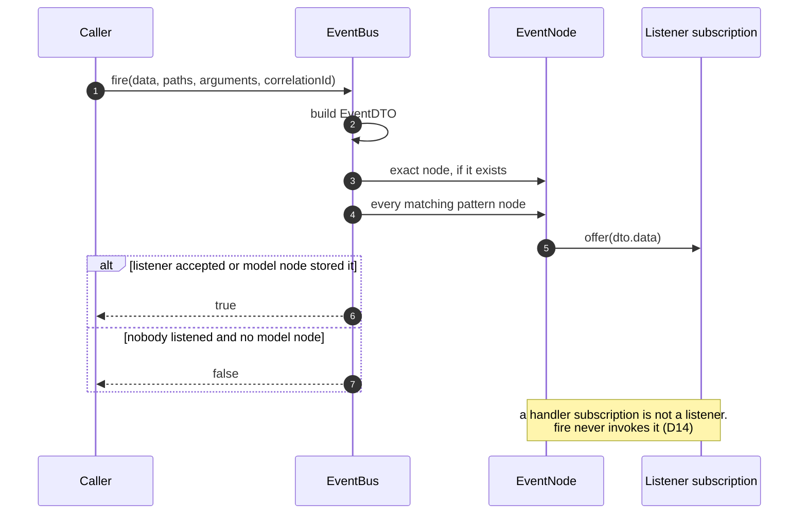
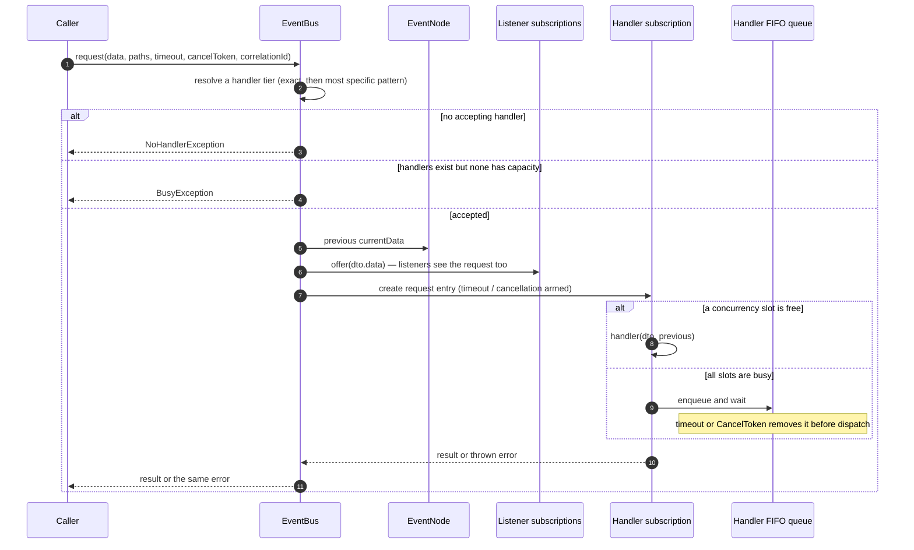
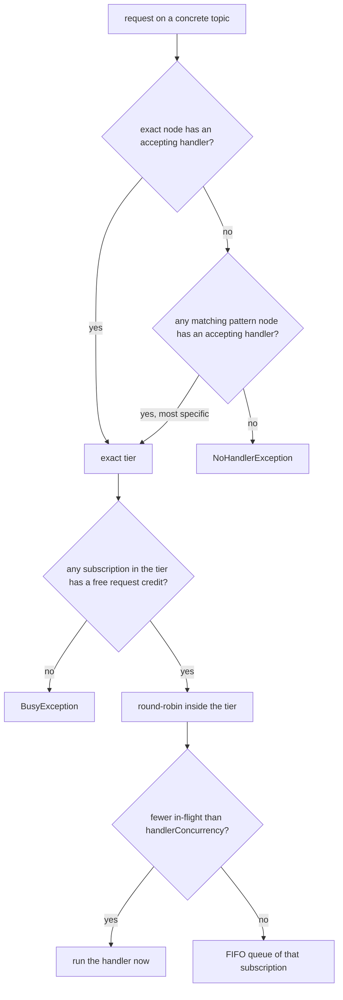
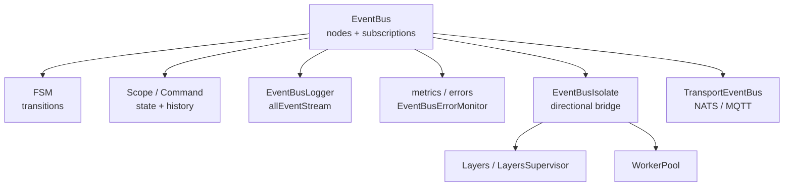

# 01. Architecture

[← Table of contents](README.md) · [Next: EventBus in practice →](02-event-bus.md)

`event_bus_arch` is an event-driven framework for Dart/Flutter. All interaction between
components goes through events that have an **address (Topic)**, **data**, and optional
**call arguments** and **correlation id**. A `fire` publishes an event; a `request` asks exactly
one handler for a result. Isolates, layers, a worker pool, a finite state machine and
scope/command are built on top of the bus.

The [overview](00-overview.md) has the API and component maps. This document explains the moving
parts in the order an event travels through them.

## What the package consists of

| Layer | Type | Role |
|---|---|---|
| Addressing | `Topic` | Event address: a type plus a path, `OrderPlaced.warehouse.in` |
| Wildcards | `TopicPattern` | `*` (one path token) and `>` (one or more trailing tokens) |
| Event envelope | `EventDTO<T>` | Data + topic + `arguments` + optional `correlationId` |
| Topic cell | `EventNode<T>` | Stores the last value, the value stream and the subscriptions of one topic |
| Subscription | `EventSubscription<T>` | Listener buffer and/or handler request queue, pause/resume/cancel |
| Registry | `EventBus` / `EventBusImpl` | Exact and pattern node maps, dispatch, errors, metrics |
| Failures | `EventBusError`, `EventBusErrorMonitor` | Errors as data, rate limiting, aggregation |
| Observability | `EventBusMetrics`, snapshots | Opt-in per-topic/subscription counters and histograms |
| Isolate boundaries | `EventBusIsolate`, `Layer`, `Layers`, `LayersSupervisor` | Directional bridges and supervised chains |
| Workers | `WorkerPool` | N isolates with a dispatch strategy and restart supervision |
| Transports | `TransportEventBus` | The same bus over a broker connection |
| On top of the bus | `FSM`, `Scope`, `Command`, `EventBusLogger` | State machine, state with history, logging |

## The two ways to publish

### `fire` — publish to listeners



`fire` is one-way. It reports whether anyone accepted the event; a handler-only node does not
make it `true`. The value is stored in `currentData` on a model bus even when nobody is listening.

### `request` — ask one handler



A dispatched handler keeps running after a timeout or cancellation; its result is discarded. A
request that timed out or was cancelled while queued is removed and never runs.

## 1. Topic — the event address

An address is a **type** followed by a **path**:

```text
String.a.b
  │    │
  │    └── paths: the free-form part, one token per path element
  └─────── type: the static type parameter T of the call
```

The routing key is the type and the paths joined by the **separator** (`.` by default):

```dart
Topic.create<String>();                                   // String
Topic.create<String>(paths: ['origin']);                  // String.origin
Topic.create<int>(paths: ['warehouse', 'in']);            // int.warehouse.in
Topic.create<int>(paths: ['a', 'b'], separator: '/');     // int/a/b
Topic.fromParametr(type: MyEvent);                        // when the type is a runtime value
Topic.parse('String.origin');                             // parsing from a string
```

`Topic.create<T>` takes the type from the **static type parameter**: `create<int>` and
`create<num>` are different addresses. The type token is normalised for broker safety: `<` becomes
`(`, `>` becomes `)`, commas and whitespace become `_`, and repeated `_` collapse. The case is
kept: `List<int>` becomes `List(int)`.

### Wildcards

`TopicPattern` defines the canonical local wildcards:

* `*` matches exactly **one** path token;
* `>` matches **one or more** trailing tokens and must be the last token;
* a wildcard must be a whole token: `sen*or` is rejected.

They are core features, not a transport detail. Transports map them to broker symbols (NATS uses
the same ones, MQTT uses `+`/`#`).

```dart
Topic.fromString('int.sensor.*');   // matches int.sensor.temp, not int.sensor.a.b
Topic.fromString('int.>');          // matches int.sensor and int.a.b, not int
```

A pattern can be registered for subscriptions and handlers. `fire` and `request` calls themselves
must address a concrete topic: a wildcard path in `fire`/`request` throws `EventBusException`.
Resolution is: the exact node first, then the most specific matching pattern (more literal tokens
win; ties keep registration order).

### Equality

`TopicImpl` compares the `topic` string only. Consequences:

* `subscribeEvents<String>(paths: ['p'])` and `fire('x', paths: ['p'], arguments: {'a': '1'})`
  address the **same** topic; `arguments` and `correlationId` are not part of the address;
* any `Topic` implementation with the same routing key finds the same node;
* `paths: ['a.b']` and `paths: ['a', 'b']` build the same `String.a.b`; use `separator: '/'` when a
  token has to contain a dot.

## 2. EventDTO — the event envelope

```dart
abstract class EventDTO<T> {
  Topic get topic;
  T get data;
  Map<String, String>? get arguments;   // parameters of this call; not part of the address
  String? get correlationId;            // ties an event and its consequences together
  EventDTO<T> copyWith({T? data, Topic? topic,
      Map<String, String>? arguments, String? correlationId});
  Map<String, dynamic> toJson();        // {'topic': ..., 'data': ..., maybe 'correlationId'}
}
```

* `arguments` are the parameters of a specific call. Two calls that differ only in `arguments`
  reach the same handler.
* There is **no completer** in the envelope. A handler returns its result; `request` awaits it.
  `fire` has no result to deliver.
* `correlationId` is optional metadata. It reaches handlers (`dto.correlationId`), crosses isolate
  and transport boundaries and appears in request error envelopes. It is editable with `copyWith`.
* `EventDTOImpl` implements `==`/`hashCode` over `(topic, data)` and supports `toJson()`/`fromJson()`.
  `toJson` returns data as is; the caller does the encoding. `arguments` are not in the JSON form.

## 3. EventNode and EventSubscription

An `EventNode<T>` owns the state of one topic. A subscription owns its own delivery state; the node
only fans events out to it.

```dart
abstract class EventNode<T> {
  T? currentData;                       // the last delivered value
  bool get isDisposed;
  StreamController<T> get streamControllerValue;

  bool deliver(EventDTO dto);           // store the value, fan out to subscriptions
  EventNode<T> copy();
  Future<void> dispose();
}

abstract class SubscriptionHost<T> {    // implemented by every built-in node
  Iterable<EventSubscription<T>> get subscriptions;
  void addSubscription(EventSubscription<T> subscription);
  void removeSubscription(EventSubscription<T> subscription);
  bool get hasSubscriptions;
  bool get hasListenerSubscriptions;
}
```

`deliver` does three things in order:

1. checks `dto.data is T`; another type is ignored;
2. sets `currentData = dto.data` synchronously;
3. adds the value to the broadcast value stream (`listen`/`subscribe`) and calls `offer` on every
   `EventSubscription`.

`EventSubscription<T>` is created by `subscribeEvents`:

| Capability | Fields / methods |
|---|---|
| Listener | `onEvent`, bounded buffer, `bufferCapacity`, `bufferOverflow` (`latest`, `dropOldest`, `dropNewest`, `reject`), `deliveryMode` (`async`/`sync`), `pause`/`resume`/`resize` |
| Handler | `handler`, `handlerConcurrency`, per-subscription FIFO `requestQueueCapacity`, `inFlight`, `bufferedRequests`, `hasRequestCapacity` |
| Lifecycle | `cancel`, `isCanceled`, `isPaused`, `isBusy`, `stream` view, counters (`delivered`, `dropped`, `buffered`) |
| Both | `onEvent` and `handler` may be set on the same subscription: it receives `fire` through `onEvent` and answers `request` through `handler` |

A handler is **not** registered on the node or in a separate registry. It is a capability of a
subscription, so its queue, concurrency, pause state and lifecycle are owned by that subscription.
See [11](11-backpressure.md) for the full buffer/queue model.

## 4. EventBus — the registry and dispatcher

```dart
abstract class EventBus {
  bool get isModelBus;
  bool get isObservable;
  String get defaultTopicPathSeparator;         // '.' unless changed
  EventBusMetrics get metrics;
  bool get isDisposed;
  Future<void> dispose();

  Stream<(EventDTO, bool)> get allEventStream;
  Stream<EventBusError> get errors;
  List<EventBusError> get recentErrors;
  int get suppressedErrors;

  bool haveListener<T>({List<String>? paths, String? separator});
  bool haveHandler<T>({List<String>? paths, String? separator});
  bool haveAvailableHandler<T>({List<String>? paths, String? separator});

  bool fire<T>(T data, {List<String>? paths, String? separator,
      Map<String, String>? arguments, String? correlationId});

  Future<dynamic> request<T>(T data, {List<String>? paths, String? separator,
      Map<String, String>? arguments, Duration? timeout,
      CancelToken? cancelToken, String? correlationId});

  Stream<T> listen<T>({List<String>? paths, String? separator});
  StreamSubscription<T> subscribe<T>({List<String>? paths, String? separator,
      void Function(T e)? onData, Function? onError,
      void Function()? onDone, bool? cancelOnError});

  EventSubscription<T> subscribeEvents<T>({List<String>? paths, String? separator,
      EventCallback<T>? onEvent, Handler<T>? handler, T? initialData,
      int handlerConcurrency, int? requestQueueCapacity,
      int? bufferCapacity, BufferOverflow bufferOverflow,
      DeliveryMode deliveryMode, ...});

  T? currentData<T>({List<String>? paths, String? separator});
  bool removeTopic<T>({List<String>? paths, String? separator});

  factory EventBus({bool isModelBus = false, ObservabilityConfig? observability});
}
```

`EventBus` is an interface with a factory: `EventBus(...)` creates `EventBusImpl`.
`EventBusImpl` mixes in `EventBusMixin` (delivery, errors, metrics, node lifecycle) and the handler
dispatch mixin (`_EventBusHandlersMixin`). Inside there are two node maps:

* `Map<Topic, EventNode> _eventsMap` — concrete topics;
* `Map<Topic, EventNode> _patternMap` — topics containing `*` or `>`.

There is no separate handler map: handler subscriptions live in the nodes.

### Handler resolution



An exact tier never falls back to a pattern tier: if the exact node has handlers and all are busy,
the request is busy instead of silently going to a pattern handler. The handler's second argument
is the **previous** `currentData` of the handler's own node. A thrown error becomes the error of the
request future. `haveHandler` counts a paused handler; `haveAvailableHandler` answers whether a
request could be accepted now.

### Two bus configurations

| | `EventBus()` — common | `EventBus(isModelBus: true)` — model |
|---|---|---|
| Creates a node on `fire` to a topic that has none | no | yes |
| What `fire` returns for an empty topic | `false` | `true` (the node stores the value) |
| `allEventStream` flag for an empty topic | `false` | `true` |
| Keeps `currentData` | only while the node has a listener, a handler or a transport pin | always |
| When the node is removed | when it has no subscriptions and no transport pin | never (until `removeTopic`/`dispose`) |

The model bus is a "state store": the value is remembered even if nobody was listening. The common
bus is a "message pipe": with no one to hand the value to, the event goes to `allEventStream` and
that is it.

### `allEventStream`

`Stream<(EventDTO, bool)>` reports every `fire` and `request`. The second element is "was there a
node that accepted the event" (a model node counts). It is used by `FSM` and `EventBusLogger`; it is
not the error stream. Errors have their own stream and are rate-limited (see [12](12-observability.md)).

## 5. Lifecycle

* `listen`/`subscribe`/`subscribeEvents` create a node if it did not exist (exact or pattern).
* A handler subscription also creates/uses a node; the first handler interest is what makes a node
  an answering tier.
* Cancelling the last subscription calls the private `_removeNode`. It removes and disposes the
  node **only if** it has no subscriptions, no `KeepAliveNode` pin, and the bus is not a model bus.
  A map entry is removed only when it still holds the same node instance, so a late cancellation of
  an old node cannot delete a newer one.
* `removeTopic` is the explicit eviction. It removes and disposes the node and forgets
  `currentData` **even on a model bus and even with a `KeepAliveNode` pin**. All subscriptions of
  the topic are cancelled (D13); a transport node cancels its broker subscription. A model bus
  creates the node again on the next `fire`, `request` or `listen`.
* Subscriptions have their own lifecycle: `EventSubscription.cancel` removes it from the node,
  drops its buffer, fails queued requests and removes the node when it was the last one.

## 6. Errors, metrics and observability

* `EventBus.errors` is a stream of `EventBusError` **data events**, never stream errors. Every
  event has a kind, a source, an optional topic/correlation id and a bounded recent buffer. The bus
  rate-limits errors per `(kind, topic)` and counts suppressed ones.
* `EventBusErrorMonitor` aggregates several buses, has an optional filter and a monitor-wide
  per-second limit and exposes counters by kind and topic.
* Observability is off by default. `EventBus(observability: ObservabilityConfig(enabled: true))`
  collects per-topic and per-subscription counters, latency histograms and queue depth;
  `metrics.snapshot()` and `metrics.changes` read them. Invalid/unknown metric keys above the
  cardinality limit go to `__other__`.
* Correlation ids travel through handlers, isolates and transport headers; they appear in request
  error envelopes. See [12](12-observability.md).

## 7. The rest of the package



| Type | What it adds | Document |
|---|---|---|
| `EventBusIsolate` | A worker isolate behind a bus-like port; interest sync, request ids, cancellation | [03](03-isolate-and-layers.md) |
| `Layers` / `LayersSupervisor` | A chain of worker layers; whole-chain restart | [03](03-isolate-and-layers.md), [13](13-pool-and-supervision.md) |
| `WorkerPool` | N isolates, five dispatch strategies, request credits, supervision | [13](13-pool-and-supervision.md) |
| `TransportEventBus` | The same bus over a broker connection | [08](08-transports.md) |
| `FSM` | A state machine driven by events | [04](04-fsm.md) |
| `Scope`/`Command` | A value with call history and undo | [05](05-scope-and-command.md) |

## What's next

| Document | Content |
|---|---|
| [02-event-bus.md](02-event-bus.md) | Sending/receiving events, handlers, addressing, recipes |
| [11-backpressure.md](11-backpressure.md) | Buffers, overflow policies, handler queues, pause, credits |
| [12-observability.md](12-observability.md) | Errors, metrics, correlation ids |
| [03-isolate-and-layers.md](03-isolate-and-layers.md) | Isolates, layers, supervision |
| [06-api-reference.md](06-api-reference.md) | Full API reference |
