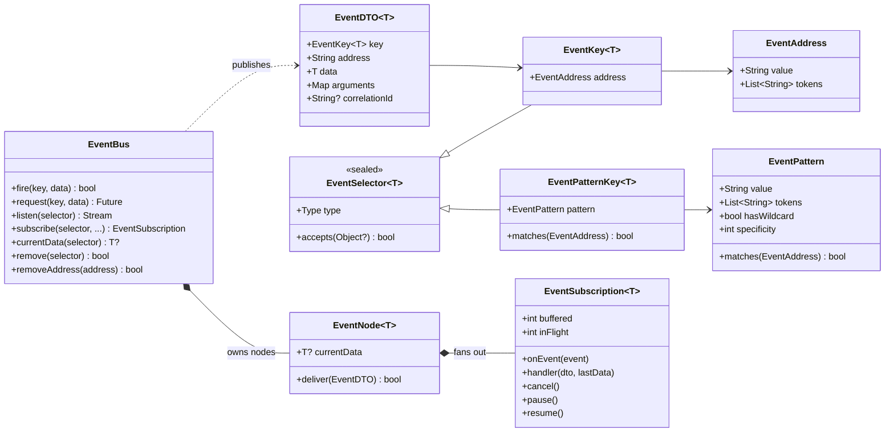

# 01. Concepts

[← Documentation index](README.md) · [Next: Event bus →](02-event-bus.md)

This page defines the objects an application works with: addresses, keys, event envelopes, nodes
and subscriptions.

## 1. Address

An **event address** is a dot-separated string chosen by the application:

```text
orders.placed.v1
   │      │    └── version in the address
   │      └─────── event name
   └────────────── domain
```

`EventAddress` validates the exact form:

```dart
EventAddress('orders.placed.v1');   // ok
EventAddress('orders.*');           // throws EventBusException: wildcard in an exact address
EventAddress('orders..placed');     // throws EventBusException: empty token
```

- The separator is `.`; it is a fixed grammar rule (`EventAddress.separator`), not a per-bus or
  per-call setting.
- An exact address has no wildcards and no empty tokens.
- The address is the identity: local node map key, metric key and wire subject.

Choose addresses deliberately. A rename of a Dart class must not change the address; a schema
change gets a new address (`orders.placed.v2`).

## 2. Patterns

`EventPattern` describes a family of addresses:

- `*` matches exactly one token: `sensor.*`;
- `>` matches one or more trailing tokens and must be the last token: `sensor.>`;
- a wildcard must be a whole token: `sen*or` is rejected.

```dart
EventPattern('sensor.*').matches(EventAddress('sensor.temp'));  // true
EventPattern('sensor.*').matches(EventAddress('sensor.a.b'));   // false
EventPattern('sensor.>').matches(EventAddress('sensor.a.b'));   // true
```

A pattern is used for subscriptions and handlers. `fire` and `request` require an exact key.

## 3. Keys and selectors

A **key** binds an address to a static Dart type:

```dart
final placed = EventKey<Order>('orders.placed.v1');
final anyOrder = EventPatternKey<Order>('orders.*');

placed.address.value;            // 'orders.placed.v1'
placed.type;                     // Type of Order
anyOrder.matches(placed.address); // true
```

`EventSelector<T>` is the sealed base of `EventKey<T>` and `EventPatternKey<T>`. Methods that can
accept a pattern (`listen`, `subscribe`, `currentData`, `probeFire`, `probeRequest`, ...) take an
`EventSelector<T>`; `fire` and `request` take an `EventKey<T>`.

### The type is local

The Dart type is **not** in the address and never reaches the wire. It is the delivery filter of a
node:

```text
node = (address, Type)
```

`EventKey<Order>('orders')` and `EventKey<Invoice>('orders')` are two nodes with separate
`currentData`; a listener on a supertype key (`EventKey<DomainEvent>`) accepts subtype payloads.

Type identity is captured from `T`:

```dart
Type _typeOf<T>() => T;
```

It survives `dart compile js -O2` and other minifiers. Do not build addresses, codec keys or metric
keys from `T.toString()`/`runtimeType`: those names are minified (a local check showed
`minified:bd` for a user class).

### Equality

| Type | Equality |
|---|---|
| `EventAddress` | `value` |
| `EventPattern` | `value` |
| `EventKey<T>` | `(address, type)` |
| `EventPatternKey<T>` | `(pattern, type)` |

`arguments` and `correlationId` are metadata on the event; they never affect routing.

## 4. EventDTO

`EventDTO<T>` is the envelope passed to listeners and handlers:

```dart
final dto = EventDTO.withKey(placed, order,
  arguments: {'priority': 'high'},
  correlationId: 'checkout-42',
);

dto.key;           // EventKey<Order>('orders.placed.v1')
dto.address;       // 'orders.placed.v1'
dto.data;          // Order
dto.arguments;     // {'priority': 'high'}
dto.correlationId; // 'checkout-42'
```

`arguments` are call parameters and are not part of the address. `correlationId` ties an event and
its consequences together and crosses isolates and transports. `toJson()` emits `address`, `data`
and optionally `correlationId`; `fromJson()` accepts the old `topic` spelling as an alias for
reading legacy payloads.

## 5. Nodes

A node owns one `(address, Type)`:

- `currentData` — the last delivered value;
- the raw value stream used by `listen`;
- the subscriptions attached to this node.

A node is created lazily by `listen`, `subscribe`, `fire` (on a model/transport bus) or `request`.
`currentData(selector)` reads the exact node or the pattern node. A pattern node stores the last
value delivered to that pattern, not a scan over matching exact nodes.

When the last subscription is cancelled, a common bus removes the node. A model bus keeps it. An
explicit `remove(selector)` removes one typed node; `removeAddress(address)` removes every type
node at an exact address.

## 6. Subscriptions

Two receiving APIs:

| API | Returns | Use when |
|---|---|---|
| `listen(selector)` | `Stream<T>` | a raw stream view is enough |
| `subscribe(selector, ...)` | `EventSubscription<T>` | you need a bounded buffer, overflow policy, pause/resume/resize, counters or a request handler |

An `EventSubscription<T>` can be:

- a **listener** (`onEvent`) — receives `fire` and request events;
- a **handler** (`handler`) — answers `request`;
- both at once.

The subscription owns its delivery state; the node only fans events out to it. Buffers, handler
queues and request cancellation are covered in [03-subscriptions.md](03-subscriptions.md).

## 7. Object model



**What to notice:** the address is the identity; the type is a separate filter; a subscription is
the unit of delivery and handler capacity, not the node.

## What's next

| Document | Content |
|---|---|
| [02-event-bus.md](02-event-bus.md) | Publishing and receiving events |
| [03-subscriptions.md](03-subscriptions.md) | Buffers, queues and request lifecycle |
| [04-isolates-and-workers.md](04-isolates-and-workers.md) | Isolates, layers and pools |
