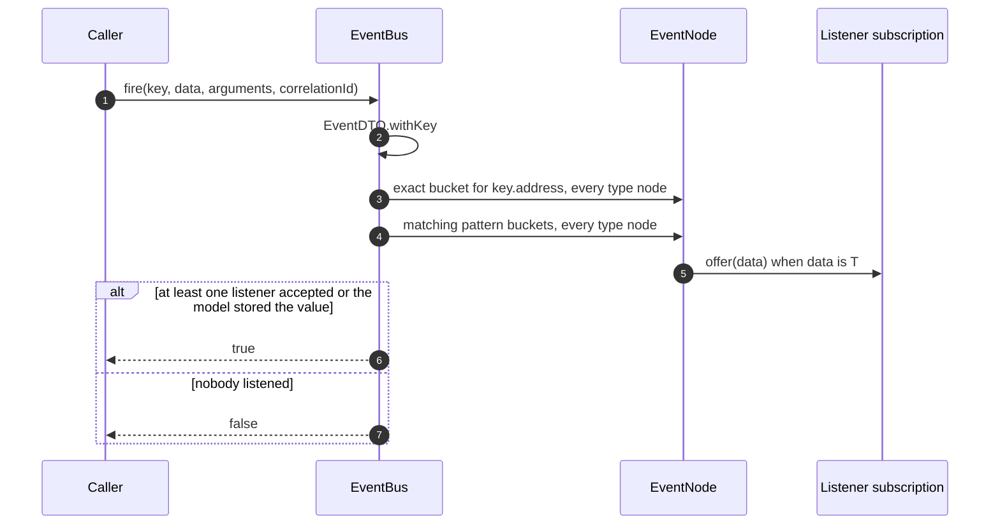
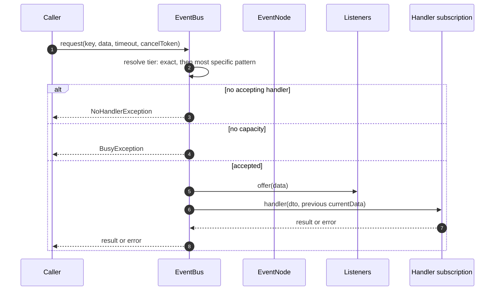

# 02. Event bus

[← Concepts](01-concepts.md) · [Documentation index](README.md) · [Next: Subscriptions →](03-subscriptions.md)

This page covers publishing and receiving events. Buffer, queue and request lifecycle details are
in [03-subscriptions.md](03-subscriptions.md).

## 1. Creating a bus

```dart
final bus = EventBus();                         // common bus
final state = EventBus(isModelBus: true);       // model bus
final observed = EventBus(
  observability: const ObservabilityConfig(enabled: true),
);
```

`EventBus(...)` returns an `EventBusImpl`. Call `await bus.dispose()` when the bus is no longer
used; it is idempotent. After `dispose`, public bus methods throw `StateError`.

## 2. `fire`

```dart
final delivered = bus.fire(orderPlaced, order,
  arguments: {'priority': 'high'},
  correlationId: 'job-42',
);
```

- `fire(key, data)` requires an exact `EventKey<T>`.
- It never invokes a handler; only listeners receive the event.
- It returns `true` when a listener accepted the event, a model bus stored it, a transport
  published it, or an isolate bridge knows a remote listener/model interest.
- A node with only a handler subscription does **not** make `fire` return `true`.
- The call does not wait for listeners; their callbacks may run later.



## 3. `request`

```dart
final receipt = await bus.request(receiptKey, order,
  arguments: {'priority': 'high'},
  timeout: const Duration(seconds: 2),
  correlationId: 'job-42',
);
```

`request` resolves exactly one handler and returns its result:

1. the exact bucket of the key;
2. otherwise the most specific matching pattern.

The exact tier never falls back to a pattern tier when it exists but is busy. While the handler
runs, listeners of the key also receive the event.

| Situation | Result |
|---|---|
| No handler | `NoHandlerException` |
| Handlers exist but none has capacity | `BusyException` |
| Timeout expired | `RequestTimeoutException` |
| Caller cancelled | `RequestCanceledException` |
| Handler threw | the handler's own error |
| Bus disposed | `StateError` |

All request exceptions expose `address` (and the alias `topic`).



A queued request is removed on timeout or cancellation; a handler that already started keeps
running and its result is discarded. See [03-subscriptions.md](03-subscriptions.md).

## 4. `listen`

`listen(selector)` returns the raw node stream:

```dart
final priceKey = EventKey<Price>('market.btc');
final stream = bus.listen(priceKey);
final sub = stream.listen((price) => print(price));

await sub.cancel();
```

The stream has no bounded buffer, overflow policy or counters. Use `subscribe` when the consumer
can be slow.

## 5. `subscribe`

`subscribe(selector, ...)` returns an `EventSubscription<T>`:

```dart
final sub = bus.subscribe(
  priceKey,
  bufferCapacity: 8,
  bufferOverflow: BufferOverflow.latest,
  onEvent: (price) async => await render(price),
  handler: (dto, lastData) async => dto.data * 2,
);

await sub.cancel();
```

- `onEvent` makes it a listener; `handler` makes it a request responder; both may be set.
- The subscription owns its buffer, request queue, pause state and counters.
- Full control reference: [03-subscriptions.md](03-subscriptions.md).

## 6. Wildcards

```dart
final anySensor = EventPatternKey<Sensor>('sensor.*');

bus.subscribe(anySensor, onEvent: (sensor) => print(sensor));

bus.fire(EventKey<Sensor>('sensor.temp'), Sensor(21)); // matches
bus.fire(EventKey<Sensor>('sensor.a.b'), Sensor(22));  // does not match
```

- `*` matches one token; `>` matches one or more trailing tokens.
- `fire`/`request` need an `EventKey`; a pattern key does not compile there.
- A pattern can answer requests:

```dart
bus.subscribe(anySensor, handler: (dto, lastData) async => dto.data.value * 2);
await bus.request(EventKey<Sensor>('sensor.temp'), Sensor(21)); // 42
```

`fire` delivers to the exact node and to every matching pattern node. `currentData(selector)`
returns the value of the exact or pattern node, not a search across concrete nodes.

## 7. `currentData`

```dart
final last = bus.currentData(priceKey);
final lastMatching = bus.currentData(anyPattern);
```

On a common bus a value lives while the node exists; on a model bus it survives until
`remove`/`removeAddress`/`dispose`.

The handler's `lastData` argument is the previous `currentData` of the handler's own node.

## 8. Availability checks

`probeFire(key, data)` and `probeRequest(key, data)` answer routing questions for the data that
would actually be sent, without publishing or invoking anything:

```dart
final fire = bus.probeFire(orderKey, order);
fire.localListeners;       // managed subscriptions that accept this Order
fire.hasRawListener;       // a listen(selector) stream has a subscriber
fire.modelStores;          // this is a model bus
fire.transportPublishes;   // a codec can publish the address
fire.remoteListenerInterest;
fire.accepted;             // any local, model, transport or remote reason

final request = bus.probeRequest(orderKey, order);
request.localHandlers;
request.localAvailableHandlers; // free handler capacity right now
request.isBusy;
```

Both probes count supertype pattern nodes: a `DomainEvent` listener accepts an `Order`. The
deprecated `haveListener`, `haveHandler` and `haveAvailableHandler` cannot see the data, so they
check only the exact registered type; they will be removed in 5.0.

## 9. Removal

```dart
bus.remove(selector);       // one typed node: exact or pattern
bus.removeAddress(address); // every type node at an exact address
await bus.dispose();        // the whole bus
```

`remove` bypasses the model-bus rule. Active listeners receive `done`; handler subscriptions are
cancelled with the node. A model bus recreates the node on the next `fire`, `request` or `listen`.
A transport node is not pinned: it is disposed, and its broker subscription cancelled, when its
last local listener/handler goes away or after a `fire` that created it only for publication.

## 10. Common bus and model bus

| | `EventBus()` | `EventBus(isModelBus: true)` |
|---|---|---|
| Creates a node on `fire` to an unknown key | no | yes |
| `fire` to a key with no node | `false` | `true`, the value is stored |
| Keeps `currentData` after the last listener | no | yes |
| Node removal | automatic after the last subscription | explicit `remove`/`removeAddress`/`dispose` |

Use a common bus for messages and a model bus for current state.

## 11. All events and errors

```dart
bus.allEventStream.listen((event) {
  final (dto, accepted) = event;
  print('${dto.address}: $accepted');
});

bus.errors.listen((error) => print('${error.address}: ${error.error}'));
```

`allEventStream` reports every `fire`/`request` with the delivery flag. `errors` carries
`EventBusError` data events; it never carries stream errors. See
[05-observability.md](05-observability.md).

## What's next

| Document | Content |
|---|---|
| [03-subscriptions.md](03-subscriptions.md) | Buffers, overflow policies, handler queues, request lifecycle |
| [04-isolates-and-workers.md](04-isolates-and-workers.md) | Isolates, layers and worker pools |
| [05-observability.md](05-observability.md) | Errors, metrics and correlation ids |
