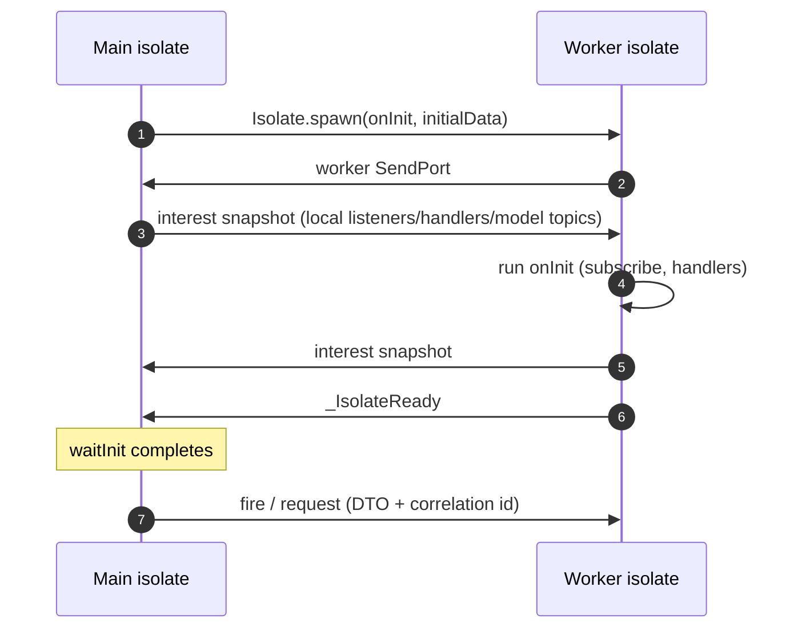

# 03. Isolates and layers

[← 02. EventBus in practice](02-event-bus.md) · [Contents](README.md) · [Next: FSM →](04-fsm.md)

`EventBusIsolate` gives a bus that looks familiar but runs its worker in another isolate. `Layers`
builds chains of such bridges: `main ↔ isolate₂ ↔ isolate₁ ↔ isolate₀`. The bridge is a
**directional port**: local listeners receive events coming from the other side, `fire` goes out.

Isolate APIs are VM-only. On the web they throw `UnsupportedError` at construction; see
[14](14-web.md).

## 1. EventBusIsolate

```dart
class EventBusIsolate extends EventBusImpl {
  EventBusIsolate({
    required FutureOr<void> Function(EventBus bus, Object? initialData) onInit,
    Object? initialData,
    bool isModelBus = false,
    ObservabilityConfig observability = ObservabilityConfig.disabled,
  });

  Future<bool> get waitInit;   // onInit finished AND interests exchanged
  bool get isInit;             // true after waitInit
  Future<bool> restart();      // restart the worker in place
  Future<bool> ping({Duration timeout});
  Future<void> dispose();
}
```

### Initialization

```dart
final iso = EventBusIsolate(onInit: _worker, initialData: 'prefix');
await iso.waitInit;
```

`onInit` runs **inside** the worker and must be top-level/static. It may be async: `waitInit`
completes after it finishes and after both sides exchange their interest registries, so a
`fire`/`request` immediately after `await waitInit` sees the subscriptions made in `onInit`.



### Publishing and request semantics

* `fire` is **outbound only**. A main-side listener does not receive a main-side fire; a worker-side
  listener does not receive its own fire. This prevents a forwarding listener from re-entering
  itself. Use a local `EventBus` (in `Layers`, `layer.current`) for local pub/sub.
* `fire` sends only when the other side has a known listener or model interest, and returns
  `true` in that case. A handler-only node does not count (D14).
* `request` checks the local side first. If a local handler exists, the request never crosses the
  bridge. Otherwise it crosses only when the worker has a known handler; with neither it throws
  `NoHandlerException` immediately. `timeout` and `CancelToken` are supported; cancelling removes a
  queued request on the worker if it was not dispatched, and a late answer is discarded.
* Incoming events are dispatched to local nodes: `fire` to listeners, `request` to the local handler.

```dart
final iso = EventBusIsolate(onInit: _worker);
await iso.waitInit;

final pingKey = EventKey<String>('ping');
final workKey = EventKey<int>('work');

iso.subscribe(pingKey, onEvent: (e) => print('from worker: $e')); // inbound listener
iso.fire(pingKey, 'ping');                                        // outbound
final doubled = await iso.request(workKey, 21);                   // worker handler
```

### Model bus

`EventBusIsolate(isModelBus: true)` makes **both** buses of the bridge model buses: the main-side
bus and the bus inside the worker. A model bus keeps the node and `currentData` after its last
listener cancels. Model interest is exchanged too, so the other side knows the address is retained
even without a listener. Firing a value does not update the sender's local model; the receiving
side stores what it receives.

### Forgetting a topic

``remove(key)`, `remove(patternKey)` and `removeAddress(address)` remove the node(s) on this
side, cancel their subscriptions and forward a delete to the other side; both sides forget the
address. A handler registered on the other side stays. A model bus recreates the node on the next
`fire`, `request` or `listen`.

### Shutdown, liveness and restart

```dart
await iso.ping();      // liveness only, not readiness
await iso.restart();   // new worker, same bus object and local subscriptions
await iso.dispose();   // cancel pending, close ports, kill the worker
```

`restart()` keeps this side's local nodes, listeners and model state, fails pending requests and
re-handshakes interests with a new worker. A generation counter ignores late messages from the old
worker. `EventBusIsolate` also starts a parent watchdog inside the worker: if the parent disappears,
the worker kills itself within about a second, so a dead parent does not leave an orphaned subtree.
See [13](13-pool-and-supervision.md) for supervised pools and chains.

### Exchange limits

* Only sendable objects can cross the isolate boundary; DTOs carry the key, `arguments` and `correlationId`.
* A request id correlates answers; concurrent requests of the same key each get their own result.
* A handler error is rethrown at the caller; an in-flight request fails with `EventBusException` if
  the worker dies or the bridge is disposed.
* `waitInit` surfaces a spawn or `onInit` error as `EventBusException`; the bus remains usable for
  `restart()` (a plain user should `dispose()` it).

## 2. Layers

`Layers.createLayers` builds a chain of worker layers and returns the top `Layer`:

```dart
final layer = await Layers.createLayers([
  LayerSpec(init: _initMiddle, isModelBus: true),   // init, optional data, isModelBus
  LayerSpec(init: _initBottom, isModelBus: true),
], bridgeIsModelBus: false);

final pingKey = EventKey<Ping>('ping');
layer.bottom!.subscribe(pingKey, onEvent: (e) => print(e.count));
layer.bottom!.fire(pingKey, Ping(0));
await layer.close();
```

```text
Main isolate (top)
  layer.current == EventBus(isModelBus: currentIsModelBus)
  layer.top     == null
  layer.bottom  == EventBusIsolate to the first worker

Worker N (layers[N] ran here)
  layer.current == EventBus(isModelBus: layers[N].$3)
  layer.top     == bridge to the layer above
  layer.bottom  == EventBusIsolate to the next worker, or null for the last layer
```

Rules:

* `layer.top!.fire/request` goes **up**; `layer.bottom!.fire/request` goes **down**;
* `layer.current` is the layer's local bus; use it for pub/sub inside the layer, never a bridge;
* `bridgeIsModelBus` applies to every inter-layer `EventBusIsolate`, not to `layer.current`;
* init functions run inside their isolate, may be async, and must be top-level/static;
* a bridge is directional: a listener on `layer.top` receives events from above and its `fire` goes
  above; it does not see its own fire locally.

### Example: a two-worker ping-pong

```dart
class Ping { final int count; Ping(this.count); }

Future<void> main() async {
  final layer = await Layers.createLayers([
    LayerSpec(init: _initMiddle, isModelBus: true),
    LayerSpec(init: _initBottom, isModelBus: true),
  ]);

  final pingKey = EventKey<Ping>('ping');
  final answer = await layer.bottom!
      .listen(pingKey)
      .firstWhere((p) => p.count == 3);

  layer.bottom!.fire(pingKey, Ping(0));
  print('result: ${answer.count}'); // 3
  await layer.close();
}

Future<void> _initMiddle(Layer layer, Object? _) async {
  await Future<void>.delayed(const Duration(milliseconds: 20));
  final pingKey = EventKey<Ping>('ping');
  layer.top!.subscribe(pingKey,
      onEvent: (e) => layer.bottom!.fire(pingKey, Ping(e.count + 1)));
  layer.bottom!.subscribe(pingKey,
      onEvent: (e) => layer.top!.fire(pingKey, Ping(e.count + 1)));
}

Future<void> _initBottom(Layer layer, Object? _) async {
  await Future<void>.delayed(const Duration(milliseconds: 20));
  final pingKey = EventKey<Ping>('ping');
  layer.top!.subscribe(pingKey,
      onEvent: (e) => layer.top!.fire(pingKey, Ping(e.count + 1)));
}
```

The same key is used in both directions on purpose: because a bridge `fire` is outbound only, a
listener cannot receive its own fire, so the chain terminates at the test listener instead of
looping.

### Supervision

`Layers.createLayers` is a factory with no recovery. `Layers.supervise` returns a
`LayersSupervisor` that restarts the whole worker chain when any worker fails while the top layer,
its `current` bus and the subscriptions on `layer.bottom` survive. Pending requests fail and are
not retried; calls on the bridge throw `StateError` while the chain is restarting. See
[13](13-pool-and-supervision.md#2-layers-supervision).

```dart
final supervisor = Layers.supervise([
  LayerSpec(init: _initMiddle, isModelBus: true),
  LayerSpec(init: _initBottom, isModelBus: true),
]);
await supervisor.waitInit;
supervisor.errors.listen(print);
await supervisor.close();
```

### Requirements for init functions

* Top-level or `static` functions: closures and bound methods cannot cross the isolate boundary.
* Everything sent into the isolate (`Layer`, `EventDTO`, event data, initial data) must be sendable.
* The function is called after the isolate has handed over its `SendPort`; the layer below is
  initialized before the current layer's init function runs.
* A worker that cannot reach its parent kills itself (watchdog); `LayersSupervisor` restarts the
  chain when the top bridge reports the failure.

[Next: FSM →](04-fsm.md)
