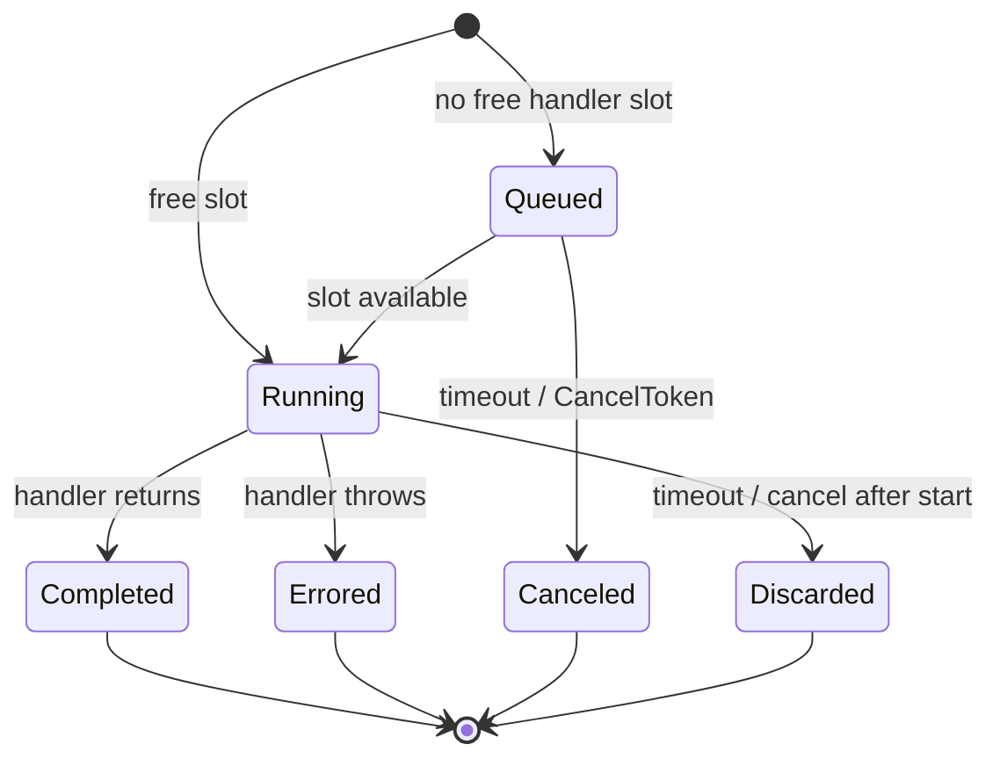

# 03. Subscriptions and requests

[← Event bus](02-event-bus.md) · [Documentation index](README.md) · [Next: Isolates and workers →](04-isolates-and-workers.md)

`subscribe` returns an `EventSubscription<T>` that owns its delivery state. `listen` is only a
raw stream view. This page explains buffers, handler capacity and the request lifecycle.

## 1. `listen` vs `subscribe`

| | `listen(selector)` | `subscribe(selector, ...)` |
|---|---|---|
| Returns | `Stream<T>` | `EventSubscription<T>` |
| Buffer | none; the Dart stream queue is unbounded and invisible | bounded by `bufferCapacity` |
| Overflow policy | none | `latest`, `dropOldest`, `dropNewest`, `reject` |
| Pause/resume | stream subscription only | subscription plus request dispatch |
| Counters | none | `delivered`, `dropped`, `buffered` |
| Handler | no | `handler:` |
| Error routing | stream `onError` | `onError` plus `bus.errors` |

Use `listen` for a simple stream consumer. Use `subscribe` for production consumers, handlers, and
anything that needs backpressure.

## 2. Listener side

```dart
final sub = bus.subscribe(
  priceKey,
  bufferCapacity: 8,
  bufferOverflow: BufferOverflow.latest,
  deliveryMode: DeliveryMode.async,
  onEvent: (price) async => await render(price),
  onError: (error, stackTrace) => log(error),
);

sub.pause();
sub.resume();
sub.resize(16, overflow: BufferOverflow.dropOldest);

print('${sub.buffered} buffered, ${sub.dropped} dropped, '
      '${sub.delivered} delivered');

final view = sub.stream; // broadcast view for UI
await sub.cancel();
```

| Option | Default | Meaning |
|---|---|---|
| `bufferCapacity` | `1024` | Events waiting while `onEvent` is busy or the subscription is paused; pass `null` for an explicit unbounded buffer |
| `bufferOverflow` | `dropOldest` | What to drop when full: `latest`, `dropOldest`, `dropNewest`, `reject` |
| `deliveryMode` | `async` | `async` schedules the callback in a microtask; `sync` invokes it inline in `fire` |
| `onError`, `cancelOnError` | — | A throwing listener is reported as `EventBusErrorKind.listener`; `cancelOnError` cancels the subscription after the first error |

- `latest` is not a sliding window: when the buffer is full it discards the whole stale backlog,
  counts those events as dropped and keeps only the newest one. `dropOldest` keeps a sliding
  window by removing one old event per incoming event.
- A `reject` overflow counts the event as dropped and does not accept it.
- `pause()` stops listener delivery; buffered events stay until `resume()`.
- `resize` changes capacity and/or policy at runtime; shrinking drops according to the policy.
- `.stream` is a convenience view, not a second delivery path with its own buffer.

## 3. Handler side

A handler is a capability of a subscription, not a global registry:

```dart
final orders = bus.subscribe(
  orderKey,
  handlerConcurrency: 2,
  requestQueueCapacity: 32,
  handler: (dto, lastData) async => await process(dto.data),
);

await orders.cancel();
```

| Option | Default | Meaning |
|---|---|---|
| `handlerConcurrency` | `1` | How many requests this subscription may run at once |
| `requestQueueCapacity` | bus setting, `64` | FIFO requests waiting for a free slot; `0` means no queue |

- `inFlight` is the number of running handlers; `bufferedRequests` is the queue depth.
- `hasRequestCapacity` answers whether a new request could be accepted now.
- `isHandlerBusy` is true when every slot is occupied.
- A handler returning a value answers the request; a thrown error is returned to the caller and
  also reported through `bus.errors` (kind `handler`).

### Handler resolution

A request picks one tier:

1. the exact bucket of the key;
2. otherwise the most specific matching pattern (more literal tokens win).

Inside a tier, subscriptions compete round-robin. An exact tier never falls back to a pattern tier
when it exists but is busy: the caller gets `BusyException`.

`lastData` in a handler is the previous `currentData` of that handler's node; `dto.data` is the
current value.

## 4. Request lifecycle

```dart
final token = CancelToken();
final result = await bus.request(
  workKey,
  21,
  timeout: const Duration(seconds: 2),
  cancelToken: token,
);
```

- **Queued request + timeout/cancel** — removed from the queue and never runs.
- **Running handler + timeout/cancel** — keeps running; its result is discarded.
- **Queued request + subscription cancel/dispose** — fails with `RequestCanceledException`; it is
  not `NoHandlerException` and must not be retried as a busy request.
- The first of response, timeout and cancellation wins.
- `RequestTimeoutException.address` and `RequestCanceledException.address` identify the request.



## 5. Combining listener and handler

One subscription can do both:

```dart
final audit = bus.subscribe(
  orderKey,
  onEvent: (order) => log('fire: $order'),
  handler: (dto, lastData) async {
    log('request: ${dto.data}');
    return 'ok';
  },
);
```

`fire` calls only `onEvent`; `request` delivers the event to listeners (including `onEvent`) and
then invokes the handler.

## 6. Closing

`cancel()` clears the buffers, fails queued requests with `RequestCanceledException`, closes the
`.stream` view and removes the subscription from its node. The close of a broadcast stream is
initiated but not awaited, so a paused external stream subscriber cannot block cancellation. If it was the last subscription on a
common bus, the node is removed. `onDone` is called when the node is disposed (`remove`,
`removeAddress`, `dispose`), not on an ordinary `cancel`.

## What's next

| Document | Content |
|---|---|
| [04-isolates-and-workers.md](04-isolates-and-workers.md) | Isolates, layers and worker pools |
| [05-observability.md](05-observability.md) | Errors, metrics and correlation ids |
| [06-api-reference.md](06-api-reference.md) | Public types and signatures |
