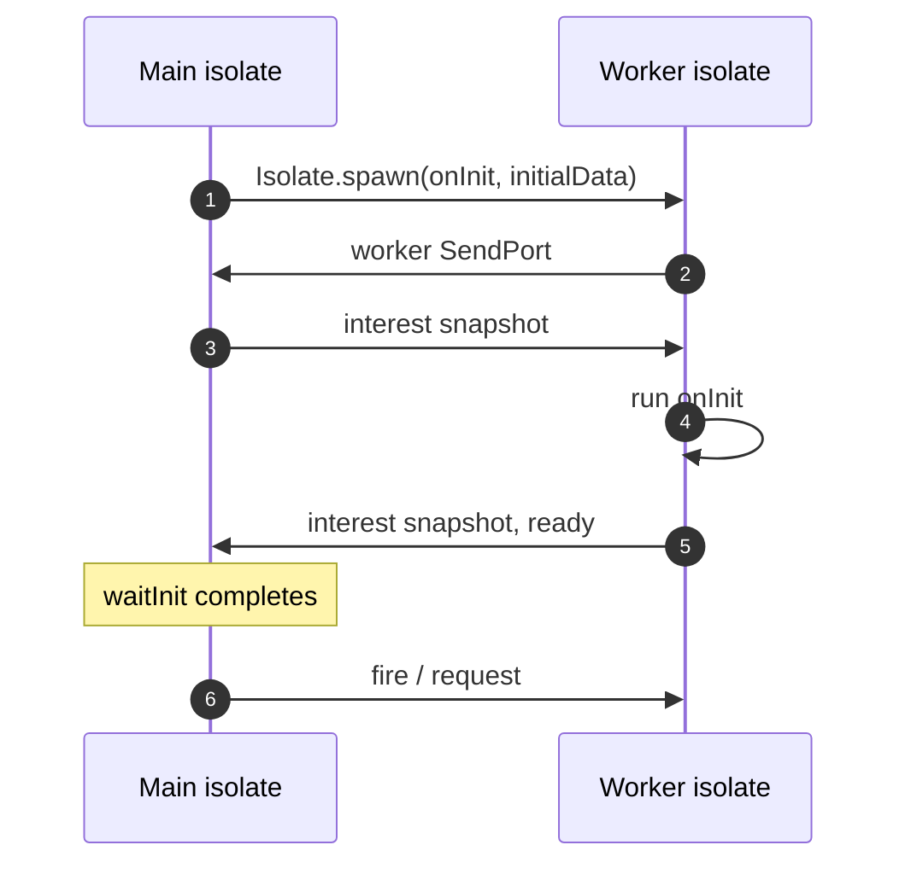

# 04. Isolates, layers and workers

[← Subscriptions](03-subscriptions.md) · [Documentation index](README.md) · [Next: Observability →](05-observability.md)

`EventBusIsolate` runs a bus in another isolate. `Layers` builds a chain of such bridges.
`WorkerPool` runs N workers with a dispatch strategy and restart supervision. These APIs are
VM-only; on the web they throw `UnsupportedError` at construction.

## 1. `EventBusIsolate`

```dart
final iso = EventBusIsolate(
  onInit: _worker,          // top-level/static
  initialData: 'worker',
  isModelBus: false,
);
await iso.waitInit;
```

```dart
class EventBusIsolate extends EventBus {
  EventBusIsolate({
    required FutureOr<void> Function(EventBus bus, Object? initialData) onInit,
    Object? initialData,
    bool isModelBus = false,
    ObservabilityConfig observability = ObservabilityConfig.disabled,
  });

  Future<bool> get waitInit;   // onInit finished and interests exchanged
  bool get isInit;
  Future<bool> restart();
  Future<bool> ping({Duration timeout});
  Future<void> dispose();
}
```

`onInit` runs inside the worker and must be top-level/static. It may be async: `waitInit`
completes after it finishes and after both sides exchange listener/handler/model interests, so
events sent right after `await waitInit` see the subscriptions made in `onInit`.



### Directional bridge

- Local listeners receive events coming from the worker.
- `fire` goes to the worker only; it is never delivered to the local side. This prevents a
  forwarding listener from re-entering itself.
- For local pub/sub use an ordinary `EventBus`; in `Layers` that is `layer.current`.
- `fire` returns `true` only when the other side has a known listener or model interest. A
  handler-only node does not count.
- `request` checks the local handler first; it crosses only when the worker has a known handler.
  With neither it throws `NoHandlerException` immediately.
- `timeout` and `CancelToken` work across the bridge: a queued request can be removed, and a late
  answer is discarded.

```dart
final pingKey = EventKey<String>('ping');
final workKey = EventKey<int>('work');

iso.subscribe(pingKey, onEvent: (e) => print('from worker: $e'));
iso.fire(pingKey, 'ping');
print(await iso.request(workKey, 21));
```

### Model bus

`EventBusIsolate(isModelBus: true)` makes both buses model buses: the main-side bus and the bus
inside the worker. The worker exchanges model interest, so the other side knows an address is
retained even without a listener.

### Removal, restart and shutdown

- `remove(selector)` and `removeAddress(address)` remove the node(s) locally and forward the
  delete to the other side.
- `restart()` replaces the worker while keeping this side's nodes, listeners and model state.
  Pending requests fail; a generation counter ignores late messages from the old worker.
- `ping()` checks liveness, not readiness.
- `dispose()` cancels pending work, closes the ports and kills the worker.

Only sendable objects cross the boundary. Keys, `arguments` and `correlationId` travel with the
DTO; a handler error is rethrown at the caller.

## 2. Layers

`Layers.createLayers` builds a chain of worker layers and returns the top `Layer`:

```dart
final layer = await Layers.createLayers([
  LayerSpec(init: _initMiddle, isModelBus: true),
  LayerSpec(init: _initBottom, initialData: 'bottom'),
], bridgeIsModelBus: true);

final pingKey = EventKey<int>('ping');
layer.bottom!.subscribe(pingKey, onEvent: (e) => print(e));
layer.bottom!.fire(pingKey, 0);
await layer.close();
```

```dart
typedef LayerInit = FutureOr<void> Function(Layer layer, Object? initialData);

class LayerSpec {
  const LayerSpec({
    required this.init,
    this.initialData,
    this.isModelBus = false,
  });

  final LayerInit init;
  final Object? initialData;
  final bool isModelBus;
}
```

```text
Main isolate (top)
  layer.current == EventBus(isModelBus: currentIsModelBus)
  layer.top     == null
  layer.bottom  == EventBusIsolate to the first worker

Worker N (LayerSpec.init ran here)
  layer.current == EventBus(isModelBus: LayerSpec.isModelBus)
  layer.top     == bridge to the layer above
  layer.bottom  == EventBusIsolate to the next worker, or null for the last layer
```

Rules:

- `layer.top!.fire/request` goes up; `layer.bottom!.fire/request` goes down.
- `layer.current` is the layer's local bus; use it for pub/sub inside the layer, never a bridge.
- `bridgeIsModelBus` applies to every inter-layer `EventBusIsolate`, not to `layer.current`.
- `LayerSpec.init` runs inside its isolate, may be async and must be top-level/static.
- A bridge is directional: it does not see its own `fire` locally.
- `createLayers` completes only when every layer is initialized; an init error surfaces as
  `EventBusException`.
- `Layer.close()` closes top, bottom and current; it is idempotent and works from any layer.

### Example: ping-pong through two workers

```dart
class Ping {
  Ping(this.count);
  final int count;
}

final pingKey = EventKey<Ping>('ping');

Future<void> main() async {
  final layer = await Layers.createLayers([
    LayerSpec(init: _initMiddle, isModelBus: true),
    LayerSpec(init: _initBottom, isModelBus: true),
  ]);

  final answer = await layer.bottom!
      .listen(pingKey)
      .firstWhere((p) => p.count == 3);

  layer.bottom!.fire(pingKey, Ping(0));
  print(answer.count); // 3
  await layer.close();
}

Future<void> _initMiddle(Layer layer, Object? _) async {
  layer.top!.subscribe(pingKey,
      onEvent: (e) => layer.bottom!.fire(pingKey, Ping(e.count + 1)));
  layer.bottom!.subscribe(pingKey,
      onEvent: (e) => layer.top!.fire(pingKey, Ping(e.count + 1)));
}

Future<void> _initBottom(Layer layer, Object? _) async {
  layer.top!.subscribe(pingKey,
      onEvent: (e) => layer.top!.fire(pingKey, Ping(e.count + 1)));
}
```

The same key is used in both directions on purpose: a bridge `fire` is outbound only, so the
chain terminates instead of looping.

## 3. `WorkerPool`

```dart
final pool = WorkerPool(
  onInit: _worker,
  workers: 4,
  dispatch: DispatchStrategy.leastBusy,
  maxInFlightPerWorker: 64,
  supervision: const SupervisionPolicy(maxRestarts: 3),
);

await pool.waitInit;
print(await pool.request(workKey, 21));
pool.fire(noteKey, 'refresh');
await pool.close();
```

`WorkerPool` is not an `EventBus`: it has no local nodes, `currentData` or subscription API.

| Strategy | Behaviour |
|---|---|
| `broadcast` | `fire` to every ready worker; requests throw `UnsupportedError` |
| `roundRobin` | rotate over ready workers |
| `keyed` | route by address (`keySelector` can override); never reroute a key |
| `leastBusy` | worker with the lowest in-flight count |
| `single` | one active worker with a standby |

- `maxInFlightPerWorker` bounds in-flight requests per worker. Without a free credit, `fire`
  returns `false` and `request` throws `BusyException`.
- A dead worker restarts with exponential backoff. Pending requests fail and are not retried.
- Restart exhaustion emits `EventBusErrorKind.supervision` and fails the pool.
- `waitInit` completes when all workers are ready; `waitReady` waits for a restart to finish.

`Layers.supervise` applies the same supervision to a layer chain:

```dart
final supervisor = Layers.supervise([
  LayerSpec(init: _initMiddle, isModelBus: true),
  LayerSpec(init: _initBottom, isModelBus: true),
]);

await supervisor.waitInit;
supervisor.errors.listen(print);
await supervisor.close();
```

Any worker layer failure restarts the whole worker chain; the top layer, its `current` bus and the
subscriptions on `layer.bottom` survive. Pending requests fail; calls on the bridge throw
`StateError` while restarting.

## What's next

| Document | Content |
|---|---|
| [05-observability.md](05-observability.md) | Errors, metrics and correlation ids |
| [06-api-reference.md](06-api-reference.md) | Public types and signatures |
| [07-platforms.md](07-platforms.md) | VM and Web support |
