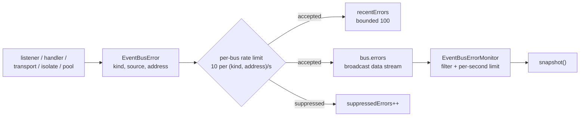

# 05. Errors and observability

[← Isolates and workers](04-isolates-and-workers.md) · [Documentation index](README.md) · [Next: API reference →](06-api-reference.md)

Failures and metrics are data, not stream errors. Collection is off by default and adds no work on
the hot path while disabled.

## 1. `EventBusError`

```dart
class EventBusError {
  final EventBusErrorKind kind;
  final EventBusErrorSource source; // core, isolate, transport, supervision
  final String? address;            // topic is an alias
  final EventDTO? event;            // null unless capturePayloads is enabled
  final String? correlationId;
  final Object error;
  final StackTrace? stackTrace;
  final DateTime timestamp;
  final Map<String, String> context;
}
```

```dart
final sub = bus.errors.listen((error) {
  log('${error.kind.name} ${error.address}: ${error.error}');
});
```

`bus.errors` is a stream of `EventBusError` **data events**. It never carries stream errors, so a
listener without `onError` does not turn a bus failure into an unhandled zone error.

| Kind | Typical cause |
|---|---|
| `listener` | An `onEvent` callback threw |
| `handler` | A request handler threw |
| `busy` | No handler capacity; pool credit exhausted |
| `requestTimeout` / `requestCanceled` | Timeout or `CancelToken` |
| `bufferOverflow` | Listener buffer policy rejected/dropped an event |
| `serialization` / `deserialization` / `transport` | A codec or broker connection failed |
| `isolateInit` / `isolateDeath` | Worker start failed or the worker died |
| `supervision` | Restart exhaustion in a pool or layer chain |
| `dispose` / `other` | Shutdown and uncategorised failures |

- Errors are rate-limited per `(kind, address)`: 10 per second by default. `suppressedErrors`
  counts the dropped ones.
- `recentErrors` keeps the last 100 envelopes.
- `EventBusError.event` is `null` unless `ObservabilityConfig(capturePayloads: true)`.

### `EventBusErrorMonitor`

```dart
final monitor = EventBusErrorMonitor(
  recentLimit: 100,
  maxErrorsPerSecond: 200, // null = unlimited
);
monitor.add(bus);

monitor.errors.listen(print);
final snapshot = monitor.snapshot();
```

`EventBusErrorSnapshot` exposes `total`, `suppressed`, `byKind`, `byAddress` (`byTopic` alias) and
`recent`. The monitor filters before counting; each bus keeps its own per-`(kind, address)` limit.



## 2. Metrics

```dart
final bus = EventBus(
  observability: const ObservabilityConfig(
    enabled: true,
    cardinalityLimit: 1000,
    sampleRate: 1.0,
    capturePayloads: false,
  ),
);

bus.fire(counterKey, 1, correlationId: 'job-42');

final snapshot = bus.metrics.snapshot();
print(snapshot.fired);
print(snapshot.topics.first.key); // 'counter'
```

| Option | Default | Meaning |
|---|---|---|
| `enabled` | `false` | Master switch; off means no metric work |
| `metrics` | `true` | Collect counters and latency samples when enabled |
| `tracing` | `false` | Reserved for exporters; does not affect metrics |
| `sampleRate` | `1.0` | Fraction of latency samples; counters are exact |
| `cardinalityLimit` | `1000` | New keys above the limit go to `__other__` |
| `capturePayloads` | `false` | Attach the event to `EventBusError.event` |
| `metricKeyBuilder` | `null` | Coarsen the key; default is the event address |

### Per-address counters

`AddressMetricsSnapshot` has `fired`, `delivered`, `dropped`, `bufferOverflow`, request counters
(`started`, `completed`, `errored`, `timeout`, `canceled`, `busy`) and dispatch/request latency
histograms.

### Per-subscription counters

`SubscriptionMetricsSnapshot` exposes buffer and queue depth, `maxBufferedRequests`, `inFlight`,
`handlerConcurrency`, delivered/dropped and queue-wait latency. The metrics are read from the
subscription itself; `subscribe` must be used for those counters to exist.

### Live changes and exporters

```dart
final changes = bus.metrics.changes.listen((snapshot) => render(snapshot));

class MyExporter implements EventBusMetricsExporter {
  @override
  void export(EventBusMetricsSnapshot snapshot) {
    // push to OpenTelemetry, Prometheus, a dashboard, ...
  }
}
```

`changes` is coalesced: at most one snapshot per microtask turn, and only while it has a listener.
The core ships no exporter; an application decides where metrics go.

### Cardinality

The default key is the **event address**. A dynamic address such as `session.<id>` can create many
series; `cardinalityLimit` bounds the registry. Above the limit, a new key is counted into
`__other__` and increments `droppedMetricSeries`; existing keys keep their counters.

## 3. Correlation id

```dart
await bus.request(orderKey, order, correlationId: 'checkout-42');

bus.subscribe(orderKey, handler: (dto, lastData) async {
  print(dto.correlationId); // checkout-42
  return 'ok';
});
```

`correlationId` is optional. It reaches handlers (`dto.correlationId`), crosses isolates and
transport headers, and appears on request error envelopes when known.

## 4. Enabling observability safely

- Keep it off unless a dashboard, exporter or error monitor is attached.
- Set `cardinalityLimit` to the number of addresses you can afford to track; use
  `metricKeyBuilder` to coarsen dynamic addresses.
- Leave `capturePayloads` off unless errors need the event payload; it retains data and can leak
  sensitive fields into logs.
- Attach `bus.errors` listeners before publishing if early failures matter.

## What's next

| Document | Content |
|---|---|
| [06-api-reference.md](06-api-reference.md) | Public types and signatures |
| [07-platforms.md](07-platforms.md) | VM and Web support |
