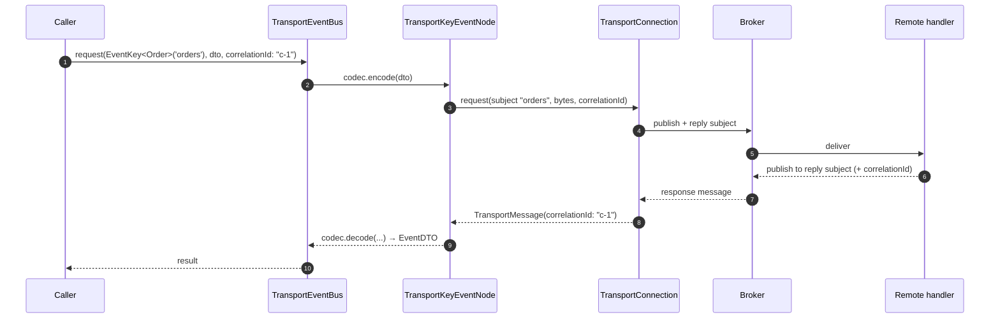

# 08. Transports

[← 07. Pitfalls](07-caveats.md) · [Contents](README.md) · [Next: event_bus_arch_nats →](09-event-bus-nats.md)

A transport runs the same bus over a broker. The core owns the delivery and dispatch semantics; the
transport package owns the wire mapping and the connection lifecycle. This document describes the
seam and the rules every adapter follows; NATS and MQTT are in [09](09-event-bus-nats.md) and
[10](10-event-bus-mqtt.md).

## 1. Packages

| Package | Version | Role |
|---|---|---|
| `event_bus_arch_transport` | 0.2.0 | `TransportConnection`, `TransportEventBus.keys`, `TransportKeyEventNode`, the reconnecting base, address mapping, typed codecs |
| `event_bus_arch_nats` | 1.1.0 | NATS adapter (`dart_nats`, TCP; VM-only) |
| `event_bus_arch_mqtt` | 0.2.0 | MQTT 5 adapter (`mqtt5_client`; VM client, `ws://`/`wss://` on the VM) |

The transport package depends on core `^4.0.0`. A 3.x adapter is not wire-compatible with 4.0: the
metadata and the isolate protocol changed.

## 2. The seam

```dart
abstract class TransportConnection {
  bool get isConnected;
  TransportStatus get status;
  Stream<TransportStatus> get statusStream;
  Stream<Object> get errors;

  Future<void> start();
  void publish(String subject, Uint8List data, {
    Map<String, String>? arguments,
    String? correlationId,
    String? originId,
    String? replyTo,
  });
  Future<TransportMessage> request(String subject, Uint8List data, {
    Map<String, String>? arguments,
    String? correlationId,
    String? originId,
    Duration? timeout,
  });
  TransportSubscription subscribe(String subject,
      void Function(TransportMessage message) onMessage);
  Future<void> close();
}
```

`TransportEventBus.keys(...)` is an `EventBusImpl` whose nodes are `TransportKeyEventNode`s. A node
resolves an `EventCodec` by address from `EventCodecRegistry`, publishes through it and delivers
incoming messages locally **without publishing them again**.



Key points:

* **No local handler?** `request` goes to the broker; with a local handler the request never leaves
  the process (same rule as an isolate bridge). `NoHandlerException` if neither side has one.
* **Headers/user properties** carry `arguments` and `correlationId`; a broker without metadata
  support cannot carry them. NATS uses headers (2.2+), MQTT 5 uses user properties.
* **Self-echo** is suppressed by the origin id (`X-EventBus-Origin`): a message published by this
  bus is ignored when it comes back. MQTT also sets `noLocal`.
* **Cancellation is local.** Broker-side cancellation is not part of the 4.0 contract: the caller's
  `timeout` bounds the wait; a busy responder sends no reply and the caller times out.
* **One connection per bus** unless a shared connection manager is introduced; disposing a bus
  closes its connection.
* **One publication per event.** Only the node whose exact key equals the DTO key publishes. A
  pattern node or a supertype node delivers locally; it must not publish a second copy.

## 3. Address mapping

The local address is a dot-separated string: `orders.placed.v1`. An `EventAddressMapper` maps it to
the broker grammar and back:

| | Local | NATS | MQTT 5 |
|---|---|---|---|
| Separator | `.` | `.` | `/` |
| Single wildcard | `*` | `*` | `+` |
| Rest wildcard | `>` (final, one or more) | `>` (final) | `#` (also zero levels) |
| Metadata | DTO fields | headers | user properties |
| Request/reply | in-process | reply subject | response topic |

```dart
final addresses = NatsAddressMapper(prefix: 'app'); // or MqttAddressMapper(...)
addresses.toSubject(EventKey<Order>('orders.placed'));
addresses.toAddress('app.orders.placed');
```

MQTT's `#` matches zero levels while the core `>` needs at least one; `TransportKeyEventNode`
filters over-delivered messages so the two grammars agree. A prefix is optional and is stripped
from incoming subjects before the address is rebuilt.

## 4. Typed codecs

```dart
typedef EventEncoder = (String?, Uint8List) Function(EventDTO dto);
typedef EventDecoder = EventDTO Function(
  Uint8List data,
  EventAddress address, {
  Map<String, String>? arguments,
});
```

`EventCodec` pairs the two directions; a codec may implement only one. `EventCodecRegistry`
resolves an exact codec first, then the most specific pattern codec.

```dart
final codecs = EventCodecRegistry(
  exact: {
    EventAddress('orders.placed.v1'): EventCodec(
      encode: (dto) =>
          (null, Uint8List.fromList(utf8.encode(jsonEncode(dto.data)))),
      decode: (data, address, {arguments}) => EventDTO.withKey(
        EventKey<Order>(address.value),
        Order.fromJson(jsonDecode(utf8.decode(data))),
        arguments: arguments,
      ),
    ),
  },
  patterns: {
    EventPattern('orders.*'): EventCodec(decode: ...), // receive-only
  },
);
```

* A key without an encoder is local-only for `fire`; a key without a decoder is not subscribed on
  the wire.
* Codec failures become `EventBusError` of kind `serialization`/`deserialization` and never crash
  the connection. The decoder returns a DTO; the node then attaches the wire correlation id with
  `copyWith`.
* The subject is the address; no type token and no `typeTags` are involved.

## 5. Reconnection

`ReconnectingTransportConnection` owns the lifecycle: status, errors, subscriptions and the backoff
schedule. A concrete adapter implements `connectClient`, `disconnectClient`, `isClientConnected`,
`publishRaw`, `subscribeRaw`, `unsubscribeRaw` and `newReplySubject`. Subscriptions are remembered
and replayed after a reconnect; a request waiting across a reconnect fails through its timeout.

```dart
const ReconnectPolicy(
  initial: Duration(seconds: 1),
  max: Duration(seconds: 30),
  multiplier: 2,
  maxAttempts: null,      // null = forever
);
```

## 6. Platform support

The seam and `TransportEventBus.keys` compile and run on the web. The shipped broker connections do
not:

* **NATS** — `dart_nats` is TCP-only; the adapter is VM-only. The NATS broker itself supports
  WebSocket, but the Dart client does not.
* **MQTT** — the adapter uses the VM `MqttServerClient`; `ws://`/`wss://` work on the VM. For the
  browser, `mqtt5_client` has `MqttBrowserClient`; wrap it in a custom `TransportConnection` and
  inject it through `connection:`.
* A web application can implement the seam over any browser WebSocket; no broker adapter in the
  browser ships in 4.0.0.

Sockets also cannot cross an isolate boundary: a transport lives in one isolate, or is proxied
through a `SendPort` (the same reason `onInit` must be top-level).

## 7. Pitfalls

1. **Wire-address stability.** The address is the wire contract. Put a version in it
   (`orders.placed.v1`) and let the codec own the schema. Never derive it from `T.toString()` or
   `runtimeType`: minification renames user classes.
2. **Broker limits.** Payload limits, header limits, retained-message semantics and MQTT user
   property size differ; a codec that works locally may be too large for the broker.
3. **Delivery guarantee.** NATS core is at-most-once, MQTT defaults to QoS 0; reconnects can lose
   the window between disconnect and resubscribe. The bus does not add broker-side durability.
4. **Self-echo.** Keep the origin id stable for a bus; without it the bus cannot filter its own
   publications, and a fire can loop through the broker.
5. **Cancellation.** There is no broker-side unsubscribe for in-flight requests; the caller's
   timeout and the responder's capacity are the controls.
6. **Request redefinition.** A broker request is answered by the first response; the transport
   resolves one local handler exactly (exact then pattern, one answer) to avoid duplicate replies.
7. **Web.** Do not instantiate the shipped NATS/MQTT connections in a browser; use the seam with a
   browser connection.
8. **Isolate + transport.** A transport is confined to its isolate; workers that need it should
   receive events through a bridge, not open their own sockets.

[Next: event_bus_arch_nats →](09-event-bus-nats.md)
