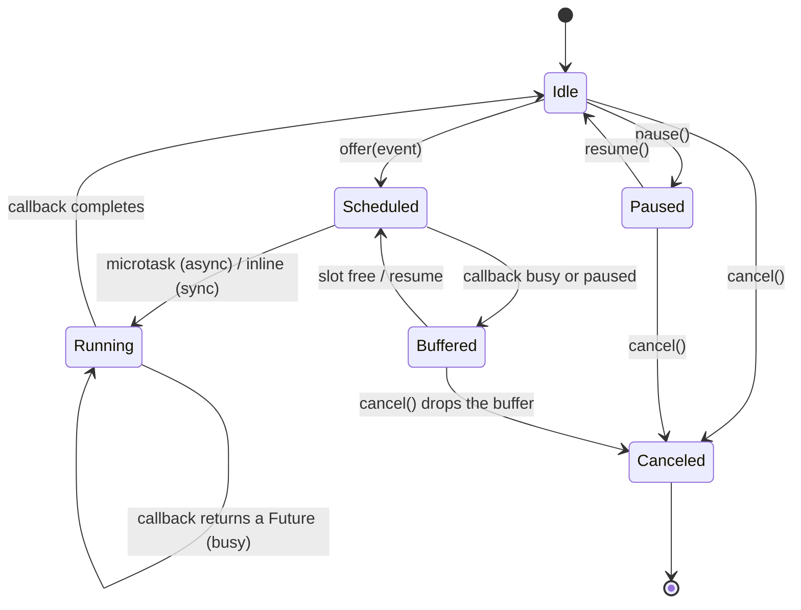
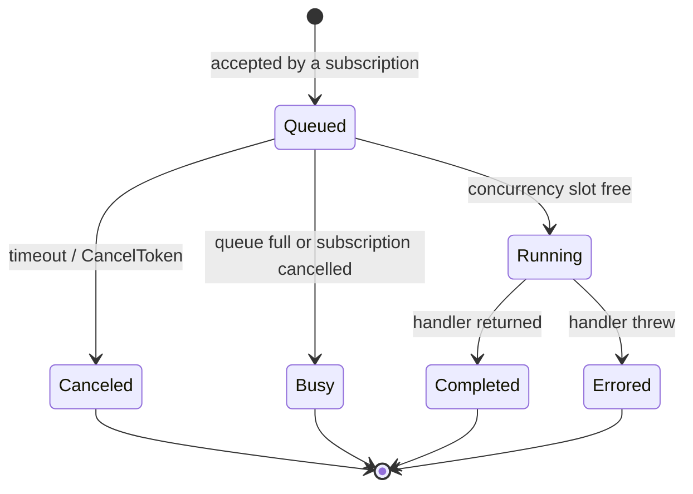

# 11. Backpressure and subscriptions

[← 01. Architecture](01-architecture.md) · [Contents](README.md) · [Next: Errors and observability →](12-observability.md)

A subscription owns every decision about delivery: when a listener callback runs, what happens when
it cannot keep up, and how many requests a handler accepts. The bus only fans events out; the
subscription's own buffer, queue and pause state implement backpressure.

> `listen` and `subscribe` are **not** part of this model. They use the node's raw broadcast
> stream: a paused legacy subscription buffers unboundedly inside the Dart stream, has no overflow
> policy or counters, and a throwing `onData` goes to the zone instead of `errors`. Use
> `subscribeEvents` for any of the controls below; the legacy facade is removed in 5.0.0
> (ADR-0001).

## 1. Listener side

`subscribeEvents(onEvent: ...)` returns an `EventSubscription<T>`. Its listener part has:

| Option | Default | Meaning |
|---|---|---|
| `bufferCapacity` | `null` (unbounded) | How many events may wait while a callback is running or the subscription is paused |
| `bufferOverflow` | `BufferOverflow.dropOldest` | What to drop when the buffer is full: `latest`, `dropOldest`, `dropNewest`, `reject` |
| `deliveryMode` | `DeliveryMode.async` | `async` schedules the callback in a microtask; `sync` invokes it inline inside `fire` |
| `onError`, `cancelOnError` | — | A listener exception is reported as an `EventBusError`; with `cancelOnError` the subscription is cancelled after the first one |

```dart
final priceKey = EventKey<Price>('market.btc');
final sub = bus.subscribeEvents(priceKey,
  bufferCapacity: 8,
  bufferOverflow: BufferOverflow.latest, // keep the newest 8
  onEvent: (price) async => await render(price),
);

sub.pause();      // stop delivering; buffered events stay
sub.resume();     // drain the buffer
sub.resize(16);   // change capacity/policy at runtime; shrinking drops per the policy
print('${sub.buffered} buffered, ${sub.dropped} dropped');
final view = sub.stream; // a broadcast view fed when the event is delivered
await sub.cancel();
```

`bufferCapacity: 0` means "no backlog": an event that cannot be delivered immediately is rejected
or dropped according to the policy. `BufferOverflow.reject` makes `fire` see that this listener did
not accept the event; the other policies count the drop and still accept it.

### Delivery pipeline



While a callback returns a `Future`, the subscription is **busy**: new events go to the buffer, not
into another concurrent callback. `isBusy` exposes that state.

## 2. Handler side

A handler is a capability of the same subscription:

```dart
final orderKey = EventKey<Order>('orders');
final sub = bus.subscribeEvents(orderKey,
  handlerConcurrency: 2,
  requestQueueCapacity: 32,
  handler: (dto, lastData) async => await process(dto),
);
```

| Concept | Behaviour |
|---|---|
| `handlerConcurrency` | How many handler invocations may run at once (default 1) |
| `requestQueueCapacity` | The subscription's own FIFO bound; defaults to the bus `requestQueueCapacity` (64); `0` means "reject immediately when no slot is free" |
| `inFlight` | Handler invocations currently running |
| `bufferedRequests` | Requests waiting in this subscription's FIFO |
| `isHandlerBusy` / `hasRequestCapacity` | Read-only state used by dispatch |
| `pause()` | Paused handlers are not selected for new requests; queued requests wait |

A handler returning a value answers `request`. An exception is both returned to the caller and
reported through `errors` (kind `handler`). Requests are dispatched by **tier** — the exact topic
first, then the most specific pattern — and round-robin inside the tier. An exact tier never falls
back to a pattern tier: if every exact handler is busy, the caller sees `BusyException`.

### Request lifecycle



A request that times out or is cancelled **before dispatch** is removed from the queue and never
runs. If it was already dispatched, the handler keeps running and its result is discarded. The
caller receives exactly one outcome: `RequestTimeoutException`, `RequestCanceledException`,
`BusyException`, `NoHandlerException` or the handler's result/error.

## 3. Combining listener and handler

Both callbacks may be set on one subscription:

```dart
final commandKey = EventKey<Command>('commands');
final sub = bus.subscribeEvents(commandKey,
  onEvent: (command) => log(command),      // fire reaches this
  handler: (dto, last) async => execute(dto), // request reaches this
);
```

`fire` only calls `onEvent`; `request` delivers the event to listeners (including this
subscription's `onEvent`) and then invokes the handler. `fire` returns `true` only for a listener,
a model node or a transport — never for a handler-only subscription (D14).

## 4. Backpressure across boundaries

* A listener buffer bounds the delay between `fire` and the callback. It does not bound the
  isolate port or a broker: those queues are managed by the bridge/transport.
* On an isolate bridge, local listeners receive incoming events; `fire` is outbound only. A slow
  listener on the other side does not block the sender, and the bridge does not add a second buffer.
* `WorkerPool` adds a per-worker **request credit** (`maxInFlightPerWorker`): a saturated worker is
  skipped; with no free credit `fire` returns `false` and `request` throws `BusyException`.
* Transports rely on the broker's own flow control; `request` is bounded by the caller's timeout.

## 5. Tuning guide

| Symptom | Start with |
|---|---|
| Latest state only, UI drops intermediate values | `bufferCapacity: 1`, `BufferOverflow.latest` |
| Every event must be processed in order | unbounded buffer (default), `deliveryMode: async` |
| Memory must stay bounded under load | small buffer + `dropOldest`/`reject`; count `dropped` |
| A handler is slow but requests must queue | `handlerConcurrency` and `requestQueueCapacity` per subscription |
| Callers must fail fast instead of waiting | `requestQueueCapacity: 0` and/or a pool credit |
| A slow worker must not get more work | `WorkerPool.maxInFlightPerWorker` (see [13](13-pool-and-supervision.md)) |

[Next: Errors and observability →](12-observability.md)
