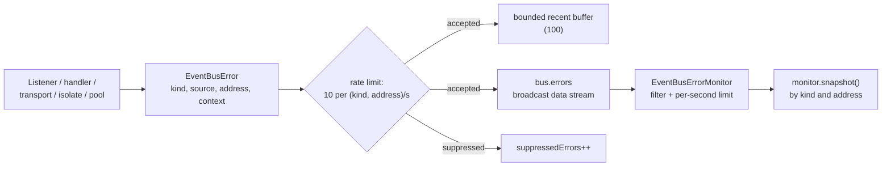
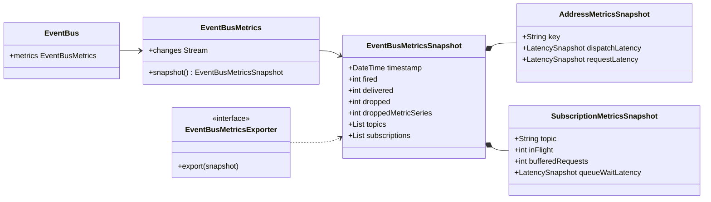

# 12. Errors and observability

[← 11. Backpressure](11-backpressure.md) · [Contents](README.md) · [Next: WorkerPool and supervision →](13-pool-and-supervision.md)

Failures and metrics are **data**. The error stream never carries stream errors, so a listener
without an `onError` cannot turn every bus failure into an unhandled zone error. Metrics are
opt-in and add no work while they are disabled.

## 1. EventBusError

```dart
class EventBusError {
  final EventBusErrorKind kind;       // listener, handler, busy, timeout, cancel, transport, ...
  final EventBusErrorSource source;   // core, isolate, transport, supervision
  final String? address;              // EventBusError.topic is an alias
  final EventDTO? event;              // only when capturePayloads is enabled
  final String? correlationId;        // when the envelope is built from a request DTO
  final Object error;
  final StackTrace? stackTrace;
  final DateTime timestamp;
  final Map<String, String> context;  // redaction-safe labels (capacity, worker, ...)
}
```

```dart
final sub = bus.errors.listen((error) {
  log('${error.kind.name} ${error.address}: ${error.error}');
});
```

| Kind | Typical source |
|---|---|
| `listener` | An `onEvent` callback threw |
| `handler` | A request handler threw |
| `busy` | No handler capacity; pool credit exhausted |
| `requestTimeout` / `requestCanceled` | Timeout or `CancelToken` |
| `bufferOverflow` | Listener buffer policy rejected/dropped an event |
| `transport` / `serialization` / `deserialization` | A broker connection or codec failed |
| `isolateInit` / `isolateDeath` | Worker start failed or the worker died |
| `supervision` | Restart exhaustion in a pool or a layer chain |
| `dispose` / `other` | Shutdown and uncategorised failures |

### Error flow



* Rate limiting is per `(kind, address)`, 10 per second by default; suppressed errors are counted in
  `suppressedErrors`. `recentErrors` keeps the last 100 envelopes for diagnostics.
* `EventBusErrorMonitor(filter: ..., recentLimit: ..., maxErrorsPerSecond: ...)` aggregates several
  buses; it can filter before counting, keeps its own bounded recent buffer and snapshot:

```dart
final monitor = EventBusErrorMonitor(
  filter: (e) => e.kind != EventBusErrorKind.listener,
  maxErrorsPerSecond: 50,
);
monitor.add(bus);
final snapshot = monitor.snapshot(); // total, suppressed, byKind, byAddress, recent
await monitor.dispose();
```

* Payloads are redacted by default (`event == null`). `ObservabilityConfig(capturePayloads: true)`
  attaches the event to listener and request errors; error messages can still contain user text.
* The error stream must not recurse: an exception thrown by an `errors` listener goes to the zone,
  not back into the stream.

## 2. Metrics

```dart
final bus = EventBus(observability: const ObservabilityConfig(
  enabled: true,
  metrics: true,
  sampleRate: 1.0,
  cardinalityLimit: 1000,
  capturePayloads: false,
));

final snapshot = bus.metrics.snapshot();
final changes = bus.metrics.changes.listen(exporter.export);
```

`enabled: false` is the default and adds one field read to the hot path. With `enabled: true` and
`metrics: true` the bus collects:

| Scope | Data |
|---|---|
| Per address | `fired`, `delivered`, `dropped`, `bufferOverflow`; requests `started`, `completed`, `errored`, `timeout`, `canceled`, `busy`; dispatch and request latency histograms |
| Per subscription | buffer and queue depth, `maxBufferedRequests`, `inFlight`, `handlerConcurrency`, delivered/dropped, queue-wait latency |
| Global | totals and `droppedMetricSeries` |

### Metric keys and cardinality

The default key is the **event address** string, so a dynamic address such as `session.<id>` can
grow the registry; `cardinalityLimit` bounds it. A custom
`metricKeyBuilder: (address) => ...` can coarsen the key.

The registry is capped by `cardinalityLimit`. A new key above the limit is counted into the
`__other__` bucket and increments `droppedMetricSeries`; existing keys keep their counters.

### Snapshot, changes and exporters



* `snapshot()` builds an immutable view; it is safe when observability is off (empty counters, but
  the subscription list still shows existing subscriptions).
* `changes` is coalesced: at most one snapshot per microtask and only while the stream has a
  listener, so a dashboard cannot make the hot path allocate per event.
* `EventBusMetricsExporter` is the seam for OpenTelemetry, Prometheus or a custom dashboard; the
  core ships no exporter. Call `exporter.export(bus.metrics.snapshot())` on your own schedule or
  from `changes`.
* `sampleRate` controls **latency samples only**; counters are exact. `sampleRate: 0` disables
  histograms, not counters.

### Overhead

`benchmark/observability_benchmark.dart` (Dart 3.14, Windows, min of five runs):

| Scenario | off | on | overhead |
|---|---:|---:|---:|
| fire, sync listener | 1316 ns | 1419 ns | +7.8% |
| request, async handler | 2302 ns | 2385 ns | +3.6% |

## 3. Correlation id

`fire` and `request` accept an optional `correlationId`:

```dart
final orderKey = EventKey<Order>('orders');
await bus.request(orderKey, order, correlationId: 'checkout-42');

bus.subscribeEvents(orderKey, handler: (dto, last) async {
  print(dto.correlationId); // checkout-42
  return await process(dto);
});
```

```mermaid
sequenceDiagram
    participant C as Caller
    participant B1 as Bus / handler
    participant I as EventBusIsolate
    participant B2 as Broker
    C->>B1: request(correlationId: "c-1")
    B1->>I: DTO carries correlationId
    I->>B2: fire/request DTO carries it
    B2-->>I: handler DTO.correlationId == "c-1"
    I-->>B1: result; request error envelope carries "c-1"
```

* Handlers see it in the received DTO; listeners receive only the value, so listener errors do not
  carry a correlation id.
* Isolates carry the DTO unchanged; transports put it in the `X-EventBus-Correlation-Id` header
  (NATS headers, MQTT 5 user properties).
* Request error envelopes copy it from the request DTO, even when metrics are off.
* It is optional and never required for metrics or delivery; use it to tie an event and every
  event it causes together.

[Next: WorkerPool and supervision →](13-pool-and-supervision.md)
