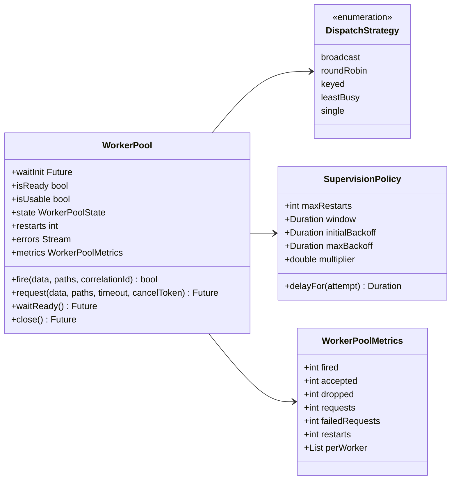
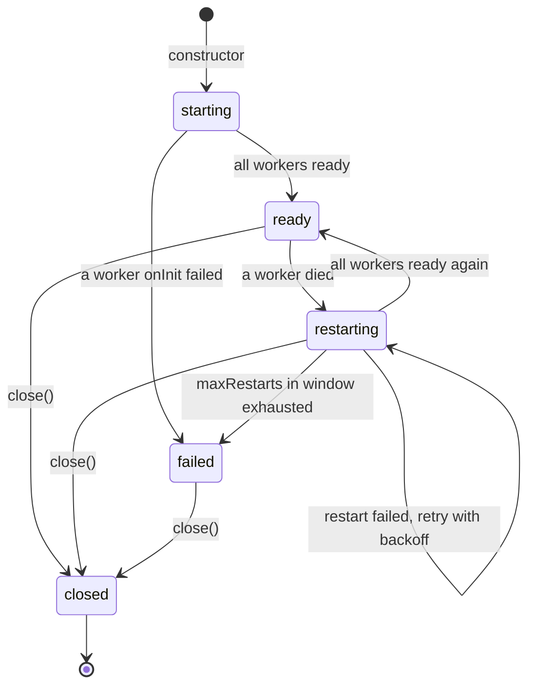
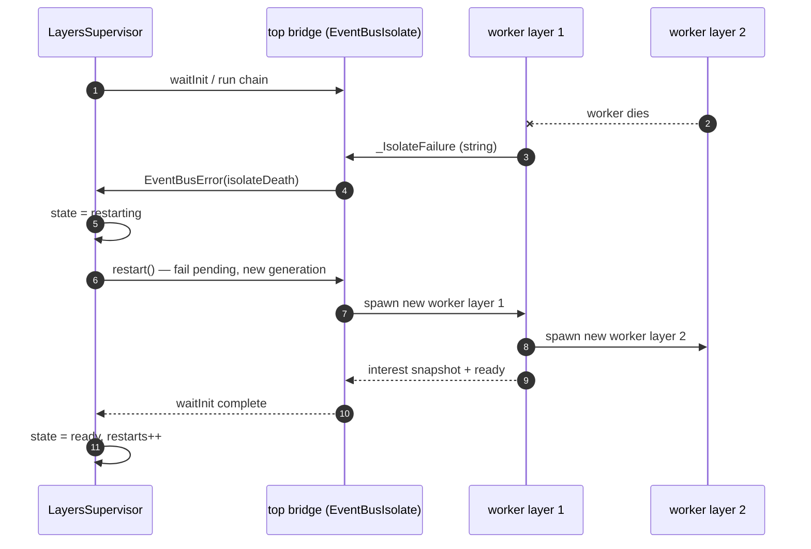

# 13. WorkerPool and supervision

[← 12. Errors and observability](12-observability.md) · [Contents](README.md) · [Next: Web and platform →](14-web.md)

`EventBusIsolate` runs one worker. `WorkerPool` runs N of them with a dispatch strategy and restart
supervision. `Layers.supervise` supervises a whole chain of worker layers. Both are VM-only: on the
web they throw `UnsupportedError` at construction (see [14](14-web.md)).

## 1. WorkerPool

```dart
final pool = WorkerPool(
  onInit: workerInit,                    // top-level/static, runs in every worker
  workers: 4,
  dispatch: DispatchStrategy.leastBusy,
  initialDataFor: (index) => index,      // or initialData for every worker
  maxInFlightPerWorker: 64,              // request credit; null = unlimited
  supervision: const SupervisionPolicy(
    maxRestarts: 5,
    window: Duration(minutes: 1),
    initialBackoff: Duration(milliseconds: 100),
    maxBackoff: Duration(seconds: 10),
  ),
  keySelector: (dto) => dto.address, // used by keyed
);

await pool.waitInit;                    // all workers ready
final answer = await pool.request(EventKey<int>('jobs'), 21);
pool.fire(EventKey<String>('note'), 'refresh');
print(pool.state);                      // ready, restarting, failed, closed
print(pool.metrics);                    // WorkerPoolMetrics snapshot
await pool.close();                     // intentional: never restarts
```

`WorkerPool` is not an `EventBus`: it has no local nodes, no `currentData` and no subscription API.
It exposes `fire`, `request`, `waitInit`, `waitReady`, `isReady`, `isUsable`, `state`, `restarts`,
`errors`, `metrics`, `close`/`dispose`.

### Dispatch strategies

| Strategy | fire | request | Ordering |
|---|---|---|---|
| `broadcast` | Every ready worker | **`UnsupportedError`** — a request needs exactly one answer | none |
| `roundRobin` | Next ready worker | Same | per worker, not global |
| `keyed` | Worker selected by `keySelector` (default: the topic path) | Same | **per key**, because a key never moves to another worker |
| `leastBusy` | Worker with the fewest in-flight requests | Same | none |
| `single` | One active worker; a ready standby takes over when it dies | Same | none |

`keyed` binds a key with `key.hashCode`; if that worker is unavailable or saturated, the call fails
(`false`/`BusyException`) instead of rerouting, so per-key order is preserved. `broadcast` requests
are rejected at call time; fan-out with several answers has no single request result.

### Backpressure and metrics

`maxInFlightPerWorker` is the request credit of one worker. A saturated worker is skipped by the
selector; when no worker has a free credit:

* `fire` returns `false` and counts a dropped event;
* `request` throws `BusyException`.

4.0.0 has no pool-level dispatch queue: callers fail fast. `metrics` exposes the counters and the
per-worker in-flight/restart state; the `errors` stream forwards worker isolates' errors and adds
`supervision` errors.



### Supervision

Worker death is detected by the isolate exit listener; pending requests fail with
`EventBusException`. A restart is scheduled with exponential backoff:



* `maxRestarts` is counted in a sliding `window`; `0` disables restarts and the first death fails
  the pool.
* On exhaustion the pool emits `EventBusError(kind: supervision)`, becomes `failed`, stops
  accepting work and disposes its workers; `close()` releases the rest.
* Pending requests are **not retried** (at-most-once): a request that lost its worker fails.
* `close()` marks shutdown as intentional; a closing worker is never restarted.
* A partially ready pool (`state == restarting`, `isUsable == true`) still routes to ready workers.

## 2. Layers supervision

`Layers.createLayers` is a factory with no recovery. For a supervised chain use
`Layers.supervise`:

```dart
final supervisor = Layers.supervise(
  [(_initMiddle, null, true), (_initBottom, null, true)],
  bridgeIsModelBus: false,
  policy: const SupervisionPolicy(maxRestarts: 3),
);

await supervisor.waitInit;
supervisor.errors.listen(print);
await supervisor.waitReady();       // after a restart
print(supervisor.state);            // starting/ready/restarting/failed/closed
print(supervisor.restarts);
await supervisor.close();
```

* **Any worker layer failure tears down the whole worker chain.** The top layer — the isolate that
  called `supervise` — survives.
* The top `Layer` object, its `current` bus and the subscriptions on `layer.bottom` survive: the
  bridge is restarted **in place** (same object), re-handshakes and re-sends interest snapshots in
  both directions. A new `onInit` runs for every worker layer.
* Pending requests fail with `EventBusException` and are not retried. While the chain is
  restarting, `fire`/`request` on the bridge throw `StateError`; `waitReady()` waits.
* A deeper failure is forwarded up as an `_IsolateFailure` message (a string only) and reported as
  `isolateDeath` on the top bridge.
* Every worker has a parent watchdog: a worker that cannot ping its parent kills itself within
  about a second, so a dead parent does not leave orphaned layers.
* A generation counter ignores late messages and callbacks from a previous worker incarnation.
* After `maxRestarts` in the window the supervisor emits `supervision`, moves to `failed` and
  disposes the bridge while keeping `layer.current` until `close()`.



**What to notice:** local application subscriptions live on the main-side bridge object; because
the object is reused, they keep receiving events from the new worker chain without re-subscribing.

## 3. Choosing between the tools

| Need | Use |
|---|---|
| One background isolate | `EventBusIsolate` |
| A fixed chain of layers with isolation between floors | `Layers` (factory) |
| A chain that must recover from a worker crash | `Layers.supervise` |
| Competing consumers on N identical workers | `WorkerPool` |
| Per-key ordering across workers | `WorkerPool(dispatch: keyed)` |
| One active worker with a standby | `WorkerPool(dispatch: single)` |
| Web | none of the above; use `EventBus` + a transport |

[Next: Web and platform →](14-web.md)
