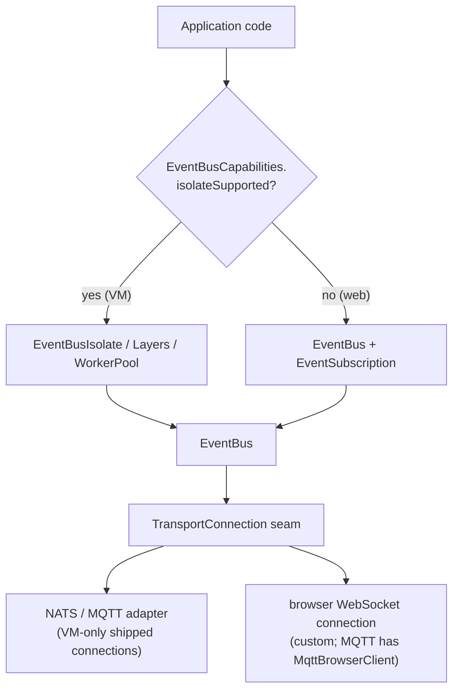

# 14. Web and platform

[← 13. WorkerPool and supervision](13-pool-and-supervision.md) · [Contents](README.md) · [Next: Migration →](15-migration-3-to-4.md)

The package has one public entry point and one `part` layout on every platform. The local bus,
subscriptions, model buses, observability and the transport seam compile and run in the browser.
The isolate APIs are VM-only and fail cleanly.

## 1. Platform matrix

| Feature | VM / Flutter mobile and desktop | Browser (JS/Wasm) |
|---|---|---|
| `EventBus`, `EventSubscription`, `listen`/`subscribe` | yes | yes |
| Model bus, `currentData`, `removeTopic` | yes | yes |
| Handler subscriptions, request lifecycle, cancellation | yes | yes |
| `errors`, `EventBusErrorMonitor` | yes | yes |
| Observability (`ObservabilityConfig`, metrics, correlation) | yes | yes |
| `TransportEventBus` (the seam) | yes | yes |
| `event_bus_arch_transport` connection seam | yes | yes |
| `event_bus_arch_nats` shipped connection | yes (`dart_nats`, TCP) | **no** — TCP-only client |
| `event_bus_arch_mqtt` shipped connection | yes (VM `MqttServerClient`; `ws://` works) | **no** — use a browser WebSocket connection |
| `EventBusIsolate`, `Layers`, `WorkerPool` | yes | **no** — `UnsupportedError` |
| `FSM`, `Scope`, `Command`, `EventBusLogger` | yes | yes |



## 2. Capability flag and guard

```dart
if (EventBusCapabilities.isolateSupported) {
  final pool = WorkerPool(onInit: workerInit, workers: 4);
  // ...
} else {
  // local bus + a transport
}

EventBusCapabilities.isWeb;             // true on JS/Wasm
EventBusCapabilities.isolateSupported;  // false on the web
EventBusCapabilities.transportSupported; // true: the seam is platform-neutral
```

The flag is compile-time (`bool.fromEnvironment('dart.library.js_interop')`), so a branch can be
tree-shaken. `EventBusIsolate`, `WorkerPool`, `Layers.createLayers` and `Layers.supervise` throw
`UnsupportedError` **at construction** on the web, before any `dart:isolate` call:

```text
UnsupportedError: EventBusIsolate is not supported on the web: dart:isolate is unavailable.
Use EventBus for local pub/sub and a transport for cross-process events.
```

## 3. Checks

```bash
# Browser smoke tests: local bus, model, subscribeEvents, observability, capability guard
dart test -p chrome test/web_smoke_test.dart

# Compile the core for the web; writes build/web_check.js
dart compile js tool/web_compile_check.dart -o build/web_check.js
```

On the VM the same source runs unchanged; Chrome tests are browser-only (`@TestOn('browser')`).

## 4. Transports on the web

The **seam** is platform-neutral: `TransportConnection` deals in subjects, byte payloads, headers
and reply subjects. A web application implements it over a browser WebSocket and passes it to
`TransportEventBus` (or `EventBusMqtt` via its `connection:` parameter):

```dart
// The browser client exists in mqtt5_client; wrap it in TransportConnection.
final connection = BrowserWebSocketTransportConnection(url);
final bus = TransportEventBus(
  connection: connection,
  subjects: mySubjects,
  serializers: {'Order': encodeOrder},
  deserializers: {'Order': decodeOrder},
  originId: newTransportOriginId(),
);
```

* **NATS:** the NATS broker supports WebSocket, but `dart_nats` is TCP-only. The shipped adapter is
  VM-only; a web application must provide a WebSocket connection.
* **MQTT:** the broker supports `ws://`/`wss://`; `mqtt5_client` ships `MqttBrowserClient` for the
  browser and `MqttServerClient` for the VM. The shipped `MqttServerConnection` uses the VM client;
  the browser client can be wrapped in a custom `TransportConnection`.
* No browser broker adapter ships in 4.0.0. The core does not depend on a browser transport.

## 5. What works and what to avoid on the web

* `DateTime.now`, microtasks and `scheduleMicrotask` used by metrics are available; observability
  is fully functional.
* `dart:isolate` is imported by the single library but its unsupported APIs are never called on the
  web thanks to the constructor guard. No library split was needed (ADR-0008).
* Do not use `WorkerPool`, `Layers` or `EventBusIsolate` in Flutter Web; they throw at construction.
  Use `EventBus` for local coordination and a broker connection for cross-process events.
* Broker adapters pull VM-only clients; importing them is fine, but constructing their shipped
  connections on the web will fail. Keep the browser path behind a custom connection.

[Next: Migration 3.x to 4.0 →](15-migration-3-to-4.md)
