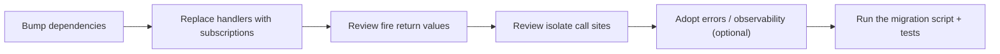

# 15. Migration 3.x to 4.0

[← 14. Web and platform](14-web.md) · [Contents](README.md)

4.0 is a breaking release. The address model (`Topic`, `fire`/`request`, wildcards) and the
`EventBus` surface stay, but the handler API, the subscription model, error reporting, isolate
behaviour and the package versions change. This guide is the shortest safe path; the mechanical
part is handled by `tool/migrate_3_to_4.dart` (E6-02).

## 1. At a glance

| Area | 3.x | 4.0 |
|---|---|---|
| Handlers | `bus.handlers.setHandler<T>(handler: ...)`, `removeHandler`, `EventBusHandlers` | `bus.subscribeEvents<T>(handler: ...)`, keep the `EventSubscription`, `cancel()` it |
| Handler concurrency / queue | node-level | per subscription: `handlerConcurrency`, `requestQueueCapacity` |
| Listener control | `listen`/`subscribe` only | `subscribeEvents(onEvent:)` with buffer, overflow policy, pause/resume/resize |
| Listener + handler | separate registrations | one subscription can have both callbacks |
| `fire` return | node accepted | listener, model storage, transport or known remote listener/model interest; a handler-only node does **not** count (D14) |
| Errors | separate streams/raw objects | `EventBus.errors` of `EventBusError`; `recentErrors`, `suppressedErrors`, `EventBusErrorMonitor` |
| Isolate `fire` | outbound only | outbound only (unchanged), but interest-aware and returns a real answer; local listeners never see it |
| Isolate `request` | always crosses; waited for timeout without a handler | local handler first; immediate `NoHandlerException`; timeout + `CancelToken`; cancellation across the bridge |
| Isolate `waitInit` | onInit completed | onInit completed **and** the interest snapshot exchanged |
| Isolate recovery | none | `EventBusIsolate.restart()`, worker watchdog, `WorkerPool`, `Layers.supervise` |
| Observability | `allEventStream` + logger | opt-in metrics, snapshots, changes, correlation ids; `allEventStream` stays |
| rxdart | re-exported | removed; import it yourself if needed |
| Versions | core 3.x | core 4.0.0; transport/MQTT 0.2.0; NATS 1.1.0 |



## 2. Handlers become subscriptions

Before:

```dart
bus.handlers.setHandler<Order>(paths: ['orders'], handler: (dto, last) async {
  return await process(dto);
});

bus.handlers.removeHandler<Order>(paths: ['orders']);

// or, historically:
bus.handlers.addAllHandlerFromOtherBus(other);
bus.handlers.removeAllHandlerPresentInOtherBus(other);
```

After:

```dart
final orders = bus.subscribeEvents<Order>(
  paths: ['orders'],
  handlerConcurrency: 2,
  requestQueueCapacity: 32,
  handler: (dto, last) async => await process(dto),
);

await orders.cancel(); // replaces removeHandler
```

* `handlerConcurrency` (default 1) and `requestQueueCapacity` (defaults to the bus setting, 64;
  `0` rejects immediately when no slot is free) are per subscription.
* `inFlight`, `bufferedRequests`, `isHandlerBusy` and `hasRequestCapacity` expose the queue state.
* Two subscriptions on the same topic compete; the bus round-robins inside the resolved tier.
  The exact tier never falls back to a pattern tier when it is busy.
* A handler returning a value answers `request`; an exception is returned to the caller **and**
  reported through `errors` (kind `handler`).
* There is no cross-bus handler copying. Create subscriptions on each bus; if you need a shared
  queue, keep one subscription and route events to it.

## 3. `fire` return semantics

`fire` now returns `true` only when at least one of these happened:

* a listener accepted the event (including a `BufferOverflow.reject` rejection? no — a rejected
  listener did not accept it);
* a model bus stored the value;
* a transport accepted it for publishing;
* the other side of an isolate bridge has a known listener or model interest.

A node that has only a handler subscription does **not** make `fire` true. In 3.x a handler created
a node, so `fire` could return true for a topic nobody listened to. If your code branched on that,
check it: the 4.0 answer is the honest one.

`fire` also accepts `correlationId` (optional). Local and remote delivery are unchanged for a
normal bus; the isolate bridge is directional (see below).

## 4. Isolates and layers

### `fire` on an isolate bridge

`fire` is **outbound only**. Local listeners on the same side do not receive the event; this is what
prevents a listener that fires the same topic from re-entering itself. Local pub/sub belongs to a
local `EventBus` (inside `Layers`, that is `layer.current`).

```dart
// before: a main-side listener could see its own fire
// after: it sees only events coming from the worker
iso.subscribe<Update>(paths: ['state'], onData: render);

// to send to the worker:
iso.fire(Update(...), paths: ['state']);

// local pub/sub:
final local = EventBus();
final sub = local.subscribeEvents<Update>(onEvent: (_) => ...);
```

### Requests

`request` checks the local side first. If a local handler exists, the request never crosses the
bridge. Otherwise it crosses only when the other side has a known handler; with neither it throws
`NoHandlerException` immediately, without waiting for a timeout. `timeout` and `CancelToken` are
supported; cancelling removes a queued request on the worker if it has not been dispatched, and a
late answer is discarded.

### Initialization and recovery

* `await iso.waitInit` now also means "the interest snapshot has been exchanged": a `fire`/`request`
  right after it sees the subscriptions made in `onInit`.
* `iso.restart()` restarts the worker in place: local nodes, listeners and model state survive;
  pending requests fail; a generation counter ignores late messages.
* New: `WorkerPool` for N workers and `Layers.supervise` for a whole-chain restart. See
  [13](13-pool-and-supervision.md).

## 5. Error handling

Before, failures could arrive through separate transport streams, raw objects, zone errors or a
failed `waitInit`. In 4.0:

```dart
final sub = bus.errors.listen((error) {
  print('${error.kind.name} ${error.topic}: ${error.error}');
});
```

* `EventBusError` is data; the stream never carries stream errors.
* `recentErrors` is a bounded buffer (100); `suppressedErrors` counts rate-limited errors.
* `EventBusErrorMonitor` aggregates several buses and offers `snapshot()`.
* `EventBusError.event` is `null` unless `ObservabilityConfig(capturePayloads: true)` is used.
* `TransportEventBus.errors` is now `Stream<EventBusError>`; a consumer that expected
  `Stream<Object>` still compiles, but code that pattern-matched raw errors must switch to
  `EventBusError.error`.
* Listener exceptions: use `subscribeEvents(onError:)` or the `errors` stream; a legacy `listen`
  still has its stream `onError` for compatibility, but the bus-level contract is the error stream.

Migration checklist:

- [ ] replace every `setHandler`/`removeHandler` with a stored `subscribeEvents` subscription;
- [ ] search for code that relied on `fire == true` for a handler-only topic;
- [ ] review every isolate `fire` that expected a local echo (use a local bus instead);
- [ ] add timeouts to remote requests and decide whether to pass a `CancelToken`;
- [ ] replace raw transport error handling with `EventBusError`;
- [ ] if you used rxdart, add it to your own dependencies (it is no longer re-exported);
- [ ] run the analyzer and the package test suites.

## 6. Observability (optional)

Nothing is collected unless you ask for it:

```dart
final bus = EventBus(observability: const ObservabilityConfig(enabled: true));
final snapshot = bus.metrics.snapshot();
```

See [12](12-observability.md). `allEventStream` and `EventBusLogger` remain available and are
independent of metrics.

## 7. Versions and packages

| Package | 4.0 line | Constraint |
|---|---|---|
| `event_bus_arch` | 4.0.0 | — |
| `event_bus_arch_transport` | 0.2.0 | `event_bus_arch: ^4.0.0` |
| `event_bus_arch_mqtt` | 0.2.0 | `event_bus_arch: ^4.0.0`, `event_bus_arch_transport: ^0.2.0` |
| `event_bus_arch_nats` | 1.1.0 | `event_bus_arch: ^4.0.0`, `event_bus_arch_transport: ^0.2.0` |

Bump the dependencies together; a 3.x adapter cannot talk to a 4.0 core (the isolate protocol and
the transport metadata changed).

## 8. Migration script

`tool/migrate_3_to_4.dart` performs the mechanical rewrite of the known public surface:

```bash
# dry run — prints findings, writes nothing
dart run tool/migrate_3_to_4.dart lib test

# apply the automatic rewrite
dart run tool/migrate_3_to_4.dart --write lib test
```

* `bus.handlers.setHandler<T>(...)` → `bus.subscribeEvents<T>(...)` is the only automatic rewrite.
  Store the returned `EventSubscription` if you will need to remove the handler later.
* `removeHandler` is reported, not rewritten: cancelling the subscription replaces it.
* `addAllHandlerFromOtherBus` / `removeAllHandlerPresentInOtherBus` are reported for manual work.
* `EventBusHandlers` type references and `rxdart` usage are reported; add rxdart to your own
  dependencies if you still need it.

The script is regex-based by design and may match comments or strings. Run it on a clean working
tree, review every finding, then follow the checklist above.

[Back to the overview](00-overview.md)
