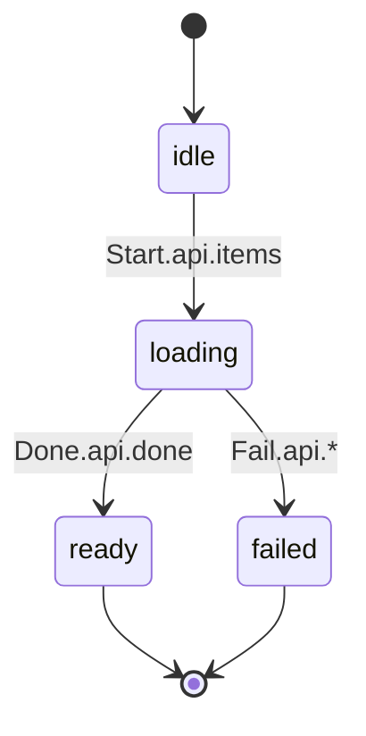

# event_bus_arch_patterns

Higher-level patterns on top of [`event_bus_arch`](https://pub.dev/packages/event_bus_arch):

- `FSM<T>` — a state machine driven by bus events;
- `Scope<T>` — a value with `lastData`, call history and `undo`;
- `Command<T>` — the call history behind a scope.

The core package stays a routing library; it does not export these types.

## Install

```yaml
dependencies:
  event_bus_arch: ^4.0.0
  event_bus_arch_patterns: ^0.1.0
```

```dart
import 'package:event_bus_arch/event_bus_arch.dart';
import 'package:event_bus_arch_patterns/event_bus_arch_patterns.dart';
```

## FSM

```dart
enum State { idle, loading, ready, failed }

class Loader with FSM<State> {
  Loader(EventBus bus) {
    initFSM(bus, State.idle);

    addFSMTransition<Start>(State.idle, State.loading,
      selector: EventKey<Start>('api.items'),
      filter: (current, last, event) => event.url.isNotEmpty,
      handler: (current, last, event, ignored) async {
        await load(event.url);
        return null;
      });

    addFSMTransition<Done>(State.loading, State.ready,
      selector: EventKey<Done>('api.done'));
    addFSMTransition<Fail>(State.loading, State.failed,
      selector: EventPatternKey<Fail>('api.*'));
  }
}
```

```dart
final bus = EventBus();
final loader = Loader(bus);

bus.fire(EventKey<Start>('api.items'), Start('/api/items')); // idle -> loading
bus.fire(EventKey<Done>('api.done'), Done());                // loading -> ready
```

```dart
mixin class FSM<T> {
  T get state;
  T get lastState;

  void initFSM(EventBus bus, T currentState, {T? lastState});

  void addFSMTransition<E>(T fromState, T toState, {
    required EventSelector<E> selector,
    FSMHandler<T, E>? handler,
    FSMFilter<T, E>? filter,
  });

  void changeState(T newState);
  @Deprecated('Use changeState') void changeStateByEvent(T newState);
  void dispose();
}
```

Rules:

- `selector` is required: an exact `EventKey<E>` or a pattern `EventPatternKey<E>`.
- The payload must be an `E` at delivery time (`data is E`).
- An exact selector beats a pattern; among patterns the most specific wins.
- A transition is registered per `(selector, fromState)`; re-registering replaces it.
- While a handler runs, incoming events go to `ignoredEvents` and are **not** replayed.
- A handler error resets the in-progress flag in a `finally`, so the machine never gets stuck.
- `dispose()` unsubscribes; `initFSM` is required before using `state`.



## Scope

```dart
final scope = Scope<int>();
await scope.initScope(
  bus,
  EventKey<int>('counter'),
  initialData: 0,
  maxLenForUndo: 10,
  onUpdate: (value) => print('value: $value'),
);

await scope.call(1);
print(scope.lastData); // 1
await scope.undo();    // re-sends the previous value
scope.disposeScope();
```

```dart
mixin class Scope<T> {
  T? lastData;
  void Function(T newData)? onUpdate;

  EventBus? get scopeBus;
  (T?, Map<String, String>?)? get lastCall;

  Future<void> initScope(EventBus bus, EventKey<T> key, {
    T? initialData,
    bool initialDataNeedExecute = true,
    int maxLenForUndo = 10,
    void Function(T newData)? onUpdate,
  });

  Future<dynamic> call(T newData, {Map<String, String>? arguments});
  Future<dynamic> undo();
  void disposeScope();
}
```

- `initScope` subscribes with `bufferCapacity: 1` and `BufferOverflow.latest`: while `onUpdate`
  is slow, the newest value wins and intermediate values are dropped.
- `initialData` goes through the bus by default (`initialDataNeedExecute: true`); set it to
  `false` to seed only `lastData`.
- `call` is a `request` when a handler exists, otherwise a `fire` (result `null`).
- `undo()` needs at least two calls in the history and returns `null` otherwise.
- `disposeScope()` cancels the scope's own subscription; it does not remove another component's
  handler.

## Command

```dart
final command = Command<int>(bus, EventKey<int>('counter'), maxLen: 10);
final result = await command.execute(1);
print(command.queueLength); // 1
await command.undo();       // re-sends the previous value, or null
```

```dart
abstract class Command<T> {
  factory Command(EventBus bus, EventKey<T> key, {int maxLen = 10});

  Future<dynamic> execute(T data, {Map<String, String>? arguments});
  Future<dynamic> undo();
  EventBus get bindedBus;
  EventKey<T> get key;
  int get queueLength;
  (T data, Map<String, String>? arguments)? get lastCall;
}
```

`execute` appends to a bounded history (`maxLen`, at least 1) and calls the bus. It sends a
request only when a local handler accepts the value type; otherwise it fires the value (a model
bus stores it) and returns `null`. `undo` with fewer than two entries returns `null`.

## Examples and tests

- [`example/fsm_example.dart`](example/fsm_example.dart)
- [`example/migration_target_example.dart`](example/migration_target_example.dart)

```bash
dart test
```
