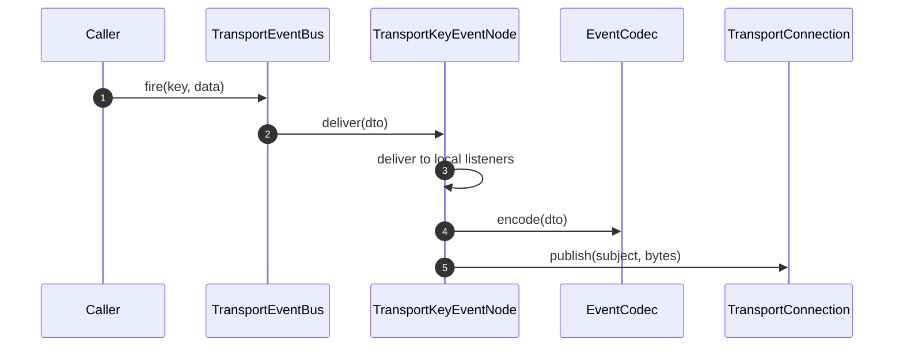

# event_bus_arch_transport

Broker-agnostic transport layer for
[`event_bus_arch`](https://pub.dev/packages/event_bus_arch). It contains no broker client and no
broker-specific grammar: a concrete transport package supplies a connection adapter and an
`EventAddressMapper`.

`event_bus_arch_nats` and `event_bus_arch_mqtt` are the adapters; they use the same layer and
differ only in the client, the grammar and the wire metadata.

## What is here

| Type | Responsibility |
|---|---|
| `TransportConnection` | The transport seam: status, errors, publish, subscribe, request |
| `TransportMessage` | One message as it exists on the wire: subject, bytes, arguments, reply subject |
| `ReconnectingTransportConnection` | Connection lifecycle, status/errors streams, subscription registry, reconnect backoff |
| `ReconnectPolicy` | Exponential backoff |
| `EventAddressMapper` | Event address ↔ wire subject, prefix, grammar validation |
| `EventCodec` | One encoder/decoder pair for an address or a pattern |
| `EventCodecRegistry` | Exact → most-specific-pattern codec resolution |
| `TransportEventBus.keys` | An `EventBusImpl` that publishes to and subscribes from a broker |
| `TransportKeyEventNode<T>` | A node that publishes outbound events and delivers inbound ones locally |
| `EventBusTransportException` and subclasses | Error types |
| `FakeTransportConnection` (`testing.dart`) | In-memory connection for tests |

## Adding a broker

1. Implement a connection adapter on top of `ReconnectingTransportConnection`:

   ```dart
   class MyConnection extends ReconnectingTransportConnection {
     @override
     Future<void> connectClient() async { /* connect the client */ }
     @override
     Future<void> disconnectClient() async { /* tear it down */ }
     @override
     bool get isClientConnected => /* client reports connected */;
     @override
     void publishRaw(String subject, Uint8List data,
         {Map<String, String>? arguments, String? originId,
          String? replyTo}) { /* publish */ }
     @override
     void subscribeRaw(int id, String subject) { /* subscribe; report via
         dispatchMessage(id, message, origin: origin) */ }
     @override
     Future<void> unsubscribeRaw(int id) async { /* unsubscribe */ }
     @override
     String newReplySubject() => /* an inbox-like subject */;
   }
   ```

   The base replays registrations after a reconnect, filters self-echo by `originId`, and
   implements `request` on top of `subscribe` + `publish`.

2. Implement an `EventAddressMapper` with the broker's separator and wildcard symbols. Local
   addresses always use `.` and the canonical wildcards `*` and `>`, which the mapper translates
   (`NatsAddressMapper`, `MqttAddressMapper`).

3. Build `TransportEventBus.keys(...)` with the connection, the mapper, an `EventCodecRegistry` and
   an origin id. `event_bus_arch_nats` is a thin subclass/factory around it.

## Publishing and subscribing

The event **address** is the wire subject. A key is published only when a codec with `encode`
resolves for it, and subscribed only when a codec with `decode` resolves. Resolution order is exact
address → most specific matching pattern.

```dart
final bus = TransportEventBus.keys(
  connection: connection,
  addresses: myAddressMapper,
  codecs: EventCodecRegistry(
    exact: {
      EventAddress('orders.placed.v1'): EventCodec(
        encode: (dto) => (null, encodeOrder(dto.data)),
        decode: (data, address, {arguments}) => EventDTO.withKey(
          EventKey<Order>(address.value),
          decodeOrder(data),
          arguments: arguments,
        ),
      ),
    },
  ),
  originId: newTransportOriginId(),
);
```



Only the node whose exact key equals the DTO key publishes; a pattern or supertype node delivers
locally without a second publication. Local delivery happens first: if the broker is unavailable,
the local listeners and `currentData` are already updated and the transport exception propagates
afterwards.

A keyed node is not pinned. When its last listener/handler is cancelled it is disposed and its
broker subscription is cancelled; a node created by a `fire` with no local subscribers is detached
after that delivery. The next `listen`/`fire` for the key creates a new node and subscribes again.
`bus.remove(selector)` remains the explicit eviction.

## Requests

`TransportEventBus.request(key, data)` keeps local semantics when a local handler accepts the data
type. Otherwise it publishes the request with a reply subject and waits for the first response.
`timeout` and `CancelToken` cancel the caller: the future fails with `RequestCanceledException`
while the underlying broker request keeps running until its own timeout, and a late response is
ignored. A node that receives a message with `replyTo` validates that subject with the address
mapper, invokes the local handler through the core `handleIncomingRequest` and publishes the
encoded result back. An invalid reply subject is reported as an error and nothing is published.
The response always goes to the reply subject; a subject returned by the encoder is ignored for
responses.

## Tests

```text
dart test
```
